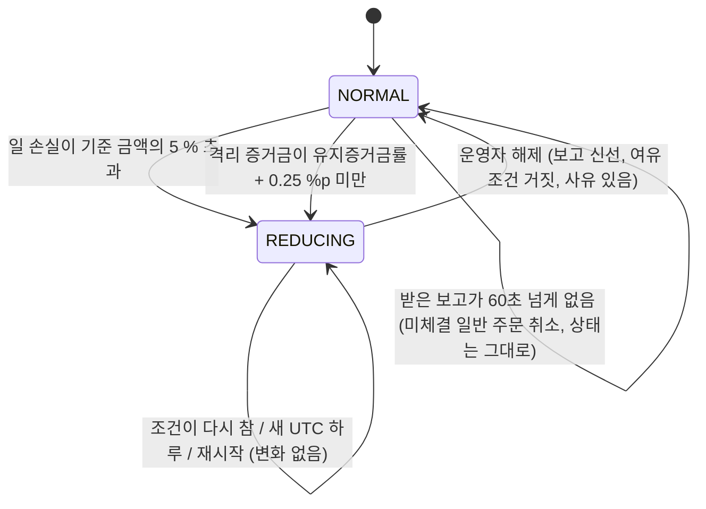

# 증거금 규칙 전체 스펙 (사장님용)

이 문서는 개발 전에 읽으시는 한글 스펙이에요. 영어 원문은 같은 폴더의 `spec.md`예요. 규칙과 숫자는 두 문서가 같아요.
티켓(작업 단위)은 같은 폴더의 `issues/`에 한 장씩 있어요.

## 결론부터

- OMS(주문 관리 시스템)에 증거금 규칙을 넣어요. 증거금은 포지션을 유지하려고 거래소에 맡겨 둔 돈이에요.
- 새 주문이 계좌를 2배 넘게 키우면 그 주문을 거절해요.
- 하루 손실이 5 %를 넘으면 계좌가 "감소 전용 상태"가 돼요. 이 상태에서는 포지션을 줄이는 주문만 받아요.
- 포지션이 강제 청산에 아주 가까워져도 감소 전용 상태가 돼요.
- 감소 전용 상태는 사장님(운영자)만 풀 수 있어요.
- OMS는 포지션을 스스로 닫지 않아요.
- 작업은 티켓 12장으로 나눴어요. 티켓마다 테스트를 먼저 쓰고 코드를 써요.
- 실제 거래소에는 주문을 한 번도 보내지 않아요. 그래서 11가지 사실(T1~T11)은 "확인 안 됨"이에요.
- 이 규칙은 손실을 5 %에서 멈춘다고 보장하지 않아요. 5초마다 확인하기 때문에 그 사이에 더 잃을 수 있어요.

## 먼저 알아둘 말

| 말 | 뜻 |
|---|---|
| 계좌 가치 | 거래소가 알려 주는 계좌 전체의 값이에요. 수수료와 펀딩(포지션 유지 비용)이 이미 빠진 값이에요 |
| 증거금 보고 | 거래소가 한 번에 답해 주는 계좌 가치와 포지션별 숫자예요. OMS가 5초마다 물어봐요 |
| 신선한 보고 | 물어본 지 30초 이하(정확히 30초 포함)인 보고예요. 30초를 넘으면 "오래된 보고"예요 |
| 일반 주문 | 감소 전용 표시가 없는 주문이에요 |
| 감소 전용 주문 | 거래소의 reduce-only 표시가 붙은 주문이에요. 거래소가 이 주문으로는 포지션을 늘리지 못하게 막아요 |
| 미체결 주문 | 접수는 됐지만 아직 다 체결되지 않고 걸려 있는 주문이에요 |
| 노출 | 걸려 있는 주문이 한쪽으로 전부 체결될 때 계좌가 가질 수 있는 가장 큰 포지션 금액이에요 |
| 계좌 레버리지 | 노출을 계좌 가치로 나눈 값이에요 |
| 거래소 레버리지 | 거래소에 종목마다 설정해 두는 배수예요. 포지션에 증거금이 얼마나 필요한지를 정해요 |
| 격리 증거금 | 포지션 하나에만 묶인 증거금이에요. 그 포지션의 손실은 이 돈까지만 가요 |
| 유지증거금률 | 포지션 가치에 대한 비율이에요. 격리 증거금이 이 비율 아래로 내려가면 거래소가 강제 청산해요 |
| 유지증거금 여유 | OMS가 유지증거금률 위에 더 얹는 거리예요. 청산보다 먼저 움직이려는 값이에요 |
| 기준 금액 | 오늘 손실을 재는 출발 금액이에요 |
| 일 손실 | 기준 금액에서 지금 계좌 가치를 뺀 값이에요 |
| UTC 하루 | 한국 시간 오전 9시부터 다음 날 오전 9시까지예요 |
| 정상 상태(NORMAL) | 감소 전용 상태가 아닌 평소 상태예요 |
| 감소 전용 상태(REDUCING) | 감소 전용 주문만 받는 상태예요. 규칙이 걸고 운영자만 풀어요 |
| 차단 | 어떤 조건이 참인 동안 새 주문을 거절하는 것이에요 |
| 규칙 취소 | 전략이나 운영자가 아니라 규칙이 낸 취소예요 |
| 해제 | 운영자가 감소 전용 상태를 푸는 명령이에요 |
| 기준 재설정 | 운영자가 기준 금액을 지금 계좌 가치로 다시 잡는 명령이에요 |
| 링크 | OMS와 거래소 사이의 연결이에요. 다시 연결될 때마다 "세션" 번호가 바뀌어요 |
| 참조 가격 | OMS가 갖고 있는 종목의 최신 중간 가격이에요 |
| 전략 | 주문을 내는 프로그램이에요 |
| 운영자 | 노드(OMS 프로그램)를 돌리는 사람이에요. 지금은 사장님이에요 |
| 거래소 설정 | 종목의 증거금 방식(격리 또는 교차)과 거래소 레버리지예요 |
| 계좌 모드 | 거래소가 계좌 전체에 적용하는 증거금 체계예요. 표준, 통합 계좌, 포트폴리오 증거금이 있어요 |
| 롱, 숏 | 롱은 산 포지션이에요. 가격이 오르면 벌어요. 숏은 판 포지션이에요. 가격이 내리면 벌어요 |
| 지정가 | 주문에 적은 가격이에요. 매수는 이 가격 이하, 매도는 이 가격 이상에서만 체결돼요 |
| 익절 주문 | 이익이 난 포지션을 정리하려고 미리 걸어 두는 주문이에요 |
| 예약 | 미체결 주문에서 아직 체결될 수 있는 수량이에요. OMS가 한도 계산에 잡아 둬요 |
| 종결 증거 | 주문이 끝났다는 거래소의 확인이에요. 전부 체결, 취소 완료, 거부가 있어요. 이 확인이 와야 예약을 풀어요 |
| 재확인 중 | 다시 연결된 뒤 OMS가 주문, 체결, 포지션을 거래소와 맞춰 보는 동안이에요. 다 맞춰 보면 끝나요 |
| 결과 불명 주문 | 보냈지만 거래소가 받았는지 모르는 주문이에요. 결과를 확인하면 끝나요 |
| 불일치 | OMS의 기록과 거래소가 서로 다른 것이에요. 막힌 취소도 여기에 들어가요. 운영자가 건마다 확인해야 끝나요 |
| 저널 | OMS가 모든 결정을 순서대로 적는 기록 장부예요. 재시작하면 이 장부에서 상태를 되살려요 |
| testnet(테스트넷), mainnet | testnet은 가짜 돈으로 연습하는 거래소예요. mainnet은 실제 돈이 오가는 거래소예요 |
| 등록부 | 결정, 계약, 주장, 테스트를 서로 이어 적어 둔 저장소 안의 목록이에요 |
| 주장 | "이 동작을 이 테스트가 증명한다"고 등록부에 적는 한 줄이에요. V-MARGIN-1 같은 번호가 붙어요 |
| 속성 테스트 | 입력을 무작위로 많이 만들어서 "항상 성립해야 하는 성질"이 깨지는지 보는 테스트예요 |
| 변이 점검 | 코드를 일부러 한 줄 망가뜨려서 테스트가 그것을 잡는지 보는 점검이에요 |
| 커밋 | 코드나 문서를 바꾼 내용을 한 덩어리로 저장한 기록이에요 |
| 브랜치, main | 브랜치는 같은 코드에서 갈라져 나온 작업 줄기예요. main은 완성된 것만 모으는 기본 줄기예요 |
| 통합 브랜치 | 이 작업의 티켓을 모두 모으는 줄기예요. 이름은 margin-rules예요. 다 끝나면 main에 합쳐요 |
| push | 내 PC에서 만든 커밋을 GitHub(코드를 올려 두는 사이트)에 올리는 일이에요 |
| PR | 한 브랜치의 바뀐 내용을 다른 브랜치에 합쳐 달라고 올리는 요청이에요. 합치기 전에 검토와 자동 점검을 받아요 |
| 머지 | 한 브랜치의 바뀐 내용을 다른 브랜치에 합치는 일이에요 |
| IP | 인터넷에서 컴퓨터를 구분하는 주소예요. 거래소는 이 주소마다 요청량을 세요 |
| clippy | Rust 코드의 흔한 실수를 찾아 주는 점검 도구예요 |

## 1. 문제 (Problem Statement)

사장님은 100 USDC로 Hyperliquid 무기한 선물 전략을 이 OMS로 돌리려고 하세요. 지금 OMS는 수량만 제한해요. 계좌를 잃게 만드는 일을 막지 못해요.

- 계좌 가치의 몇 배가 되는 포지션을 만들 수 있는 주문을 받아요. 미체결 주문과 계좌 가치를 보지 않기 때문이에요.
- 하루에 이미 크게 잃은 날에도 새 주문을 계속 받아요.
- 격리 포지션이 청산에 가까워도 몰라요.
- 거래소의 레버리지나 증거금 방식이 계획과 달라도 알아채지 못해요.
- 지금은 모든 차단이 모든 주문을 막아요. 포지션을 줄이기만 하는 주문도 막아요. 그래서 "줄이기만 허용"하는 상태를 만들 수 없어요.
- 미체결 주문을 누가 관리하는지가 한곳에 적혀 있지 않아요.

## 2. 해결 (Solution)

증거금 정책을 설정하면 OMS가 5초마다 증거금 보고를 받아서 아래 규칙을 적용해요. 정책을 설정하지 않으면 OMS는 전과 똑같이 동작해요.

1. **레버리지 검사.** 새 일반 주문이 계좌 노출을 계좌 가치의 2배 위로 올리면 거절해요. 노출은 포지션과 모든 미체결 주문을 최악의 경우로 세요. 이 규칙은 상태를 바꾸지 않아요.
2. **일 손실.** 계좌 가치가 기준 금액보다 5 % 넘게 내려가면 감소 전용 상태가 돼요.
3. **유지증거금 여유.** 포지션의 격리 증거금이 포지션 가치의 (유지증거금률 + 0.25 %p) 아래로 내려가면 감소 전용 상태가 돼요.
4. **감소 전용 상태.** 일반 주문을 거절해요. 걸려 있는 일반 주문을 취소해요. 감소 전용 주문은 받고, 걸려 있는 것도 그대로 둬요. OMS는 포지션을 닫지 않아요. 운영자만 풀 수 있어요. 풀면 그때의 계좌 가치가 새 기준 금액이 돼요.
5. **오래된 보고.** 신선한 보고가 없으면(30초 초과) 일반 주문을 거절해요. 받은 보고가 60초 넘게 없으면 걸려 있는 일반 주문을 취소해요. 이 규칙은 상태를 바꾸지 않아요.
6. **거래소 설정과 계좌 모드.** OMS는 읽기만 하고 바꾸지 않아요. 종목의 거래소 설정이 다르거나 모르면 그 종목의 일반 주문을 막아요. 계좌 모드가 다르거나 모르면 계좌의 일반 주문을 막아요.
7. **차단 표.** 재확인 중, 결과 불명 주문, 불일치, 감소 전용 상태, 거래소 설정, 계좌 모드 차단은 일반 주문만 막아요. 감소 전용 주문은 통과해요. 이것도 증거금 정책을 설정했을 때만 그래요. 정책이 없으면 지금처럼 모든 차단이 모든 새 주문을 막아요.
8. **미체결 주문.** 언제 취소하고 다시 낼지는 전략이 정해요. OMS는 미체결 주문을 추적하고, 레버리지 검사에 세고, 감소 전용 상태나 보고 끊김 때 일반 주문이면 취소해요.

개발 전에 중요한 시나리오 25개(S1~S25)를 드려요. 시나리오마다 OMS 동작, 증명할 테스트, 그 테스트가 보장하는 것과 보장하지 않는 것을 적었어요.

## 3. 사용자 이야기 (User Stories)

번호는 영어 원문과 같아요.

1. 사장님은 계좌를 2배 넘게 키우는 주문이 거절되길 원해요. 전략 오류가 감당 못 할 포지션을 만들지 못하게요.
2. 사장님은 미체결 주문을 최악의 체결로 세길 원해요. 아직 체결 안 된 주문이 나중에 한도를 넘기지 못하게요.
3. 사장님은 레버리지 한도가 설정값이길 원해요. 코드를 고치지 않고 바꾸려고요.
4. 사장님은 정확히 한도에 닿는 주문은 받길 원해요. 경계에서 규칙이 예측 가능하게요.
5. 사장님은 노출을 모든 종목에 걸쳐 더하길 원해요. 두 종목이 각각 한도를 다 쓰지 못하게요.
6. 사장님은 시장보다 훨씬 높은 매도 주문을 그 지정가로 세길 원해요. 실제로 체결될 가격을 덮으려고요.
7. 사장님은 UTC 하루에 5 % 넘게 잃으면 위험을 더하는 거래가 멈추길 원해요. 나쁜 하루가 계좌를 비우지 못하게요.
8. 사장님은 일 손실을 저널(OMS의 기록 장부)에 저장된 기준 금액으로 재길 원해요. 재시작이 손실을 지우지 못하게요.
9. 사장님은 자정 뒤 첫 보고를 어제 기준으로 먼저 판정하길 원해요. 공백 동안의 손실이 묻히지 않게요.
10. 사장님은 새 UTC 하루가 감소 전용 상태를 풀지 않길 원해요. 다시 거래할지는 사람만 정하게요.
11. 사장님은 수수료와 펀딩도 손실로 세길 원해요. 5 % 규칙이 계좌의 실제 값을 보게요.
12. 사장님은 격리 포지션이 청산에 가까우면 감소 전용 상태가 되길 원해요. 위험한 계좌에 더 얹지 않게요.
13. 사장님은 한 종목의 유지증거금 여유 경고가 모든 종목의 일반 주문을 멈추길 원해요. 계좌 전체를 지키려고요.
14. 사장님은 OMS가 포지션을 스스로 닫지 않길 원해요. 자동 시장가 주문이 사장님 이름으로 나가지 않게요.
15. 사장님은 실제 일 손실이 5 %보다 클 수 있다는 것을 알길 원해요. 규칙을 보장으로 읽지 않으려고요.
16. 사장님은 중요한 시나리오와 각각의 증명 테스트 목록을 원해요. 무엇을 만들었는지 통제하려고요.
17. 사장님은 중요한 테스트가 보장하는 것과 보장하지 않는 것을 읽길 원해요. 통과한 테스트를 실제보다 더 믿지 않으려고요.
18. 사장님은 테스트넷에서만 확인되는 사실이 "확인 안 됨"으로 적히길 원해요. 실제 돈까지 무엇이 남았는지 알려고요.
19. 사장님은 증거금 정책 없이는 mainnet(실제 돈이 오가는 거래소)이 거부되길 원해요. 규칙을 빼먹지 못하게요.
20. 사장님은 증거금 정책이 없으면 규칙이 꺼지길 원해요. 기존 동작과 테스트와 저널이 그대로 유효하게요.
21. 운영자는 사유를 꼭 적어야 하는 `clear-reduce`(해제) 명령을 원해요. 모든 해제가 이유와 함께 기록되게요.
22. 운영자는 해제가 지금 계좌 가치를 새 기준 금액으로 삼길 원해요. 5초 뒤에 다시 걸리지 않게요.
23. 운영자는 해제 뒤에 5 %를 더 잃으면 다시 멈추길 원해요. 해제가 한도 없는 손실 허가가 되지 않게요.
24. 운영자는 보고가 오래됐을 때 해제가 거부되길 원해요. 옛 숫자로 풀지 않으려고요.
25. 운영자는 유지증거금 여유 조건이 참인 동안 해제가 거부되길 원해요. 청산 근처의 포지션에 위험을 더하지 못하게요.
26. 운영자는 `rebase-day`(기준 재설정) 명령을 원해요. 입금이나 출금이 일 손실을 왜곡하지 않게요.
27. 운영자는 상태 화면에 상태(정상 또는 감소 전용), 건 규칙, 기준 금액, 계좌 가치와 그 나이, 계좌 노출이 보이길 원해요. 주문이 왜 거절되는지 보려고요.
28. 운영자는 상태 화면에 종목별 거래소 설정과 계좌 모드가 보이길 원해요. 거래소에서 고치려고요.
29. 운영자는 마지막 증거금 보고가 왜 거부됐는지 보이길 원해요. 거래소 문제와 네트워크 문제를 구분하려고요.
30. 운영자는 감소 전용 상태와 기준 금액이 강제 종료와 재시작 뒤에도 남길 원해요. 장애가 계좌를 풀어 주지 않게요.
31. 운영자는 규칙의 결정과 저널 기록 사이에서 죽어도 상태가 일관되길 원해요. 재시작 뒤 손으로 고칠 일이 없게요.
32. 운영자는 전략 소켓(전략이 붙는 통로)에서는 해제와 기준 재설정이 안 되길 원해요. 전략이 스스로 풀지 못하게요.
33. 운영자는 증거금 보고가 60초 넘게 끊기면 걸려 있는 일반 주문이 취소되길 원해요. 못 보는 동안 주문이 계속 체결되지 않게요.
34. 운영자는 거래소 레버리지나 증거금 방식이 설정과 다른 종목이 막히길 원해요. 계획하지 않은 증거금을 쓰지 않게요.
35. 운영자는 계좌가 통합 계좌나 포트폴리오 모드이면 막히길 원해요. 그 모드에서는 규칙이 읽는 숫자에 의미가 없어요.
36. 운영자는 시작할 때 조회량을 거래소 요청 한도와 비교하길 원해요. 종목을 늘려도 증거금 보고가 밀리지 않게요.
37. 운영자는 해야 할 일 목록을 원해요. 규칙이 적힌 대로 동작하게요.
38. 전략 개발자는 감소 전용 상태에서 감소 전용 주문이 받아들여지길 원해요. 포지션을 닫으려고요.
39. 전략 개발자는 재확인 중, 결과 불명 주문, 미확인 불일치 때에도 감소 전용 주문이 받아들여지길 원해요. 운영 문제가 포지션을 가두지 않게요.
40. 전략 개발자는 분명한 거절 사유(`AccountLeverage`, `MarginUnavailable`, 이름 있는 차단)를 원해요. 코드가 맞게 반응하게요.
41. 전략 개발자는 표시 없는 익절 주문이 감소 전용 상태와 보고 끊김 취소에서 취소된다는 것을 알길 원해요. 줄이는 주문마다 표시를 하려고요.
42. 전략 개발자는 OMS가 미체결 주문의 가격을 고치거나 만료시키지 않는다는 것을 알길 원해요. 취소와 재전송은 전략의 일이에요.
43. 전략 개발자는 가격이 움직여 한도를 넘은 뒤에도 노출을 줄이는 일반 주문은 받아들여지길 원해요. 표시 없이도 위험을 낮추려고요.
44. 전략 개발자는 감소 전용 주문에 신선한 보고가 필요 없길 원해요. 거래소 조회가 실패하는 동안에도 줄이려고요.
45. 전략 개발자는 감소 전용 주문도 전략의 포지션 한도 검사를 받길 원해요. OMS의 수량 불변식이 유지되게요.
46. 전략 개발자는 취소한 주문의 노출이 종결 증거가 올 때까지 남길 원해요. 검사가 취소가 됐다고 가정하지 않게요.
47. 전략 개발자는 거래소가 거부한 주문의 노출이 풀리길 원해요. 거래소 거부가 한도를 잡아먹지 않게요.
48. 검토자는 시나리오 행마다 규칙을 깨면 실패하는 테스트가 있길 원해요. 규칙을 깨서 보장을 확인하려고요.
49. 검토자는 테스트의 기대값이 손으로 계산한 숫자이길 원해요. 테스트가 규칙의 공식을 그대로 반복하지 않게요.
50. 검토자는 마지막 관문 전에 규칙 코드에 변이 점검(코드를 일부러 망가뜨려 테스트가 잡는지 보는 점검)을 돌리길 원해요. 어떤 테스트도 지키지 않는 줄을 찾으려고요.
51. 검토자는 레버리지 검사가 들어간 뒤 성능을 다시 재길 원해요. 비용을 가정하지 않고 측정하려고요.
52. 검토자는 여러 UTC 하루와 재시작을 포함한 모의 실행을 원해요. 날짜 넘김과 감소 전용 상태를 긴 시간으로 함께 시험하려고요.
53. 개발자는 모든 증거금 이벤트가 등록부의 계약 C-MARGIN 아래에 있길 원해요. 연결표가 빠짐없게요.
54. 개발자는 티켓마다 자기 테스트, 주장, 변이, 계약 문구를 갖길 원해요. 머지할 때마다 통합 브랜치가 검증 가능하게요.
55. 개발자는 더 새로운 보고를 받은 뒤에 늦게 온 보고가 무시되길 원해요. 느린 응답이 상태를 뒤로 돌리지 못하게요.
56. 개발자는 읽지 못한 증거금 보고가 통째로 거부되고 사유와 함께 기록되길 원해요. 반만 읽은 보고가 규칙을 움직이지 못하게요.

## 4. 구현 결정 (Implementation Decisions)

### 원칙

- 상태를 거는 규칙(일 손실, 유지증거금 여유)은 거래소의 증거금 보고만 읽어요. OMS 장부가 틀려도 이 규칙은 꺼지지 않아요.
- OMS 장부를 읽는 규칙(레버리지 검사)은 주문 한 건만 거절해요. 최악의 실패가 주문 한 건의 잘못된 수용이나 거절이에요.

### 바뀌는 부분

- **코어**(판단을 내리는 부분): 정책 항목, 새 입력과 이벤트, 레버리지 검사, 두 규칙, 감소 전용 상태, 차단 표, 보고 끊김 취소, 운영자 명령이 들어가요. 모든 상태 변화는 저널 이벤트로 일어나고 재생으로 복원돼요.
- **설정**: 증거금 정책은 선택 항목이에요. 노드가 시작할 때 값을 검사해요.
- **대조기**(거래소에 주기적으로 물어보는 부분): 5초마다 증거금 보고를 따로 조회해요. 연결될 때와 60초마다 거래소 설정과 계좌 모드를 조회해요. 기존 15초 훑기는 바꾸지 않아요.
- **가상 거래소**: 새 조회에 답해요. 계좌 가치, 증거금 숫자, 설정, 모드를 시험에서 바꿀 수 있어요.
- **Hyperliquid 게이트웨이**: 조회 요청을 만들고 답을 읽어요. 읽을 수 없는 답은 사유와 함께 거부해요.
- **운영자 도구와 상태 화면**: `clear-reduce`, `rebase-day` 명령과 새 상태 항목이 들어가요.
- **시뮬레이션**: 거래소 증거금 모형, 새 프로필, 새 불변식, 여러 날 프로필이 들어가요.
- **검증 도구**: 규칙 코드의 변이, 증거금 정책을 켠 벤치마크, 등록부 행이 들어가요.

### 설정값

| 값 | 기본 | 검사 |
|---|---|---|
| 계좌 레버리지 한도 `max_account_leverage` | 2.0 | 0보다 커야 해요 |
| 일 손실 한도 `daily_loss_bps` | 500 (5 %) | 0보다 커야 해요 |
| 유지증거금 여유 `mm_buffer_bps` | 25 (0.25 %p) | 0 이상이어야 해요 |
| 신선도 한도 `margin_max_age_us` | 30초 | 0보다 커야 해요 |
| 보고 끊김 취소 한도 `stale_cancel_us` | 60초 | 신선도 한도보다 커야 해요 |
| 거래소 레버리지 `venue_leverage` | 2 | 1 이상이어야 해요 |
| 증거금 방식 `isolated` | 격리 | — |
| 허용 계좌 모드 `account_modes_allowed` | 비어 있음 | 통합 계좌와 포트폴리오 증거금은 적어도 허용되지 않아요 |
| 증거금 보고 조회 간격 `margin_poll_ms` | 5초 | 0보다 커야 해요 |
| 거래소 설정 조회 간격 `venue_setting_poll_ms` | 60초 | 0보다 커야 해요 |

- 증거금 정책은 선택 항목이에요. 없으면 규칙이 꺼져요.
- mainnet을 켰는데 증거금 정책이 없으면 노드가 시작을 거부해요.

### 증거금 보고 받기

- 링크가 올라와 있어야 받아요.
- 보고의 세션이 지금 세션이어야 받아요.
- 조회마다 순번이 붙어요. 이미 받은 보고보다 순번이 크지 않으면 버려요. 버린 보고는 저장하지도 판정하지도 않아요.
- 순서는 시각이 아니라 순번으로 정해요. 시계가 뒤로 갈 수 있기 때문이에요.
- 숫자 하나라도 읽지 못하면 보고 전체를 거부해요. 최대 레버리지가 없거나 0이어도 거부해요. 거부와 사유를 저널에 남겨요.
- 거부해도 마지막 정상 보고는 남아요. 그 보고가 나이를 먹어요.
- 설정에 없는 종목의 포지션도 버리지 않아요.
- 받은 보고 하나는 이 순서로 처리해요: 기록 → 거래소 설정 갱신 → 유지증거금 여유 판정 → 일 손실 판정 → 날짜 넘김.
- 받은 보고는 모두 판정해요. 도착했을 때 이미 30초보다 오래된 보고도 판정해요.
- 링크가 바뀌면 거래소 설정과 계좌 모드는 "모름"이 돼요. 마지막 보고, 기준 금액, 감소 전용 상태는 남아요.

### 신선도

- 보고의 나이는 기록 시각에서 조회 시각을 뺀 값이에요.
- 나이가 0 이상 30초 이하면 신선해요. 정확히 30초는 신선해요.
- 조회 시각이 기록 시각보다 미래면 신선하지 않아요.
- 신선한 보고가 없으면 일반 주문을 `MarginUnavailable`(증거금 정보 없음)로 거절해요.
- 감소 전용 주문은 신선한 보고가 없어도 돼요.
- 노출이 있는 종목에 신선한 참조 가격이 없어도 일반 주문을 `MarginUnavailable`로 거절해요.

### 레버리지 검사

종목마다 이렇게 계산해요. 주문은 감소 전용을 포함한 모든 미체결 주문의 남은 수량이에요.

```
위쪽   = max(0,  포지션 × 참조가격 + 매수 주문 합(수량 × max(지정가, 참조가격)))
아래쪽 = max(0, −포지션 × 참조가격 + 매도 주문 합(수량 × max(지정가, 참조가격)))
종목 노출 = max(위쪽, 아래쪽)
계좌 노출 = 모든 종목 노출의 합
```

- 받은 뒤 노출이 `한도 × 계좌 가치`보다 크고, 받기 전 노출보다도 크면 일반 주문을 `AccountLeverage`(계좌 레버리지 초과)로 거절해요.
- 정확히 한도와 같으면 받아요.
- 계좌 가치가 0 이하면 거절해요.
- 감소 전용 주문은 이 검사를 건너뛰어요. 그래도 다음 주문을 검사할 때 합에는 들어가요.
- 주문을 받기 전에만 검사해요. 가격이 움직여 한도를 넘어도 상태가 걸리지 않고 취소도 없어요.
- 수량은 OMS 장부에서 읽어요. 증거금 보고의 수량은 쓰지 않아요.
- 가격은 참조 가격(중간 가격)을 써요. 마크 가격(거래소가 청산 계산에 쓰는 가격) 피드는 넣지 않아요.
- 취소를 요청한 것만으로는 노출이 줄지 않아요. 종결 증거가 와야 줄어요.
- 예: 계좌 가치 100, 가격 100일 때 2.00개 매수는 받고 2.01개 매수는 거절해요.

### 일 손실과 기준 금액

- 기준 금액은 저널의 이벤트로만 바뀌어요.
- 받은 보고마다 이 순서로 해요.
  1. 기준이 있고 `(기준 − 계좌 가치)`가 기준의 5 %보다 크면 감소 전용 상태로 들어가요.
  2. 기준이 없거나 보고의 UTC 날짜가 기준의 날짜보다 뒤면, 이 보고의 계좌 가치가 새 기준이 돼요.
- 기준이 100이면 95.00은 걸리지 않고 94.99는 걸려요.
- 보고의 날짜가 기준의 날짜보다 앞이면 그 보고는 기준을 바꾸지 않아요. 보고 때문에 날짜가 뒤로 가는 일은 없어요. 앞선 날짜로 둘 수 있는 것은 운영자의 기준 재설정과 해제뿐이에요.
- 부팅은 기준을 바꾸지 않아요. 새 날은 감소 전용 상태를 풀지 않아요.
- 수수료와 펀딩은 계좌 가치에 들어 있어요. 그래서 손실로 세요.
- 출금은 손실로 읽혀요. 입금은 그 금액만큼의 손실을 가려요. 기준 재설정을 하거나 다음 UTC 하루가 되면 끝나요.

### 유지증거금 여유

- 받은 보고에서 포지션 가치가 0보다 큰 격리 포지션마다 판정해요.
- 조건은 `격리 증거금 < (유지증거금률 + 0.25 %p) × 포지션 가치`예요. 참이면 감소 전용 상태로 들어가요.
- 유지증거금률은 `1 ÷ (2 × 최대 레버리지)`예요. 최대 레버리지는 같은 보고에서 읽어요. 설정에 적지 않아요.
- 예: 최대 레버리지 40, 포지션 가치 200이면 격리 증거금 2.99는 걸리고 3.00은 걸리지 않아요.

### 감소 전용 상태

- 운영자 중지와 같은 방식으로 저장해요. 이벤트로 켜고 꺼요.
- 들어가는 순간, 감소 전용이 아닌 열린 주문 가운데 취소 요청이 없거나 취소 시도가 다 된 주문 모두에 규칙 취소를 내요. 이미 취소가 진행 중인 주문에는 다시 내지 않아요.
- 아직 전송 결과를 기다리는 주문은 취소 요청을 기록해 둬요. 거래소가 접수한 뒤에 취소를 보내요.
- 그 뒤 일반 주문은 `Hold(Reducing)`으로 거절해요. 포지션을 줄이는 방향이어도 표시가 없으면 거절해요.
- 감소 전용 주문은 받아요. 걸려 있는 감소 전용 주문은 그대로 둬요.
- 한 번만 들어가요. 이미 감소 전용 상태이면 새 이벤트도 새 취소도 없어요. 처음 건 규칙이 남아요.
- 계좌 전체에 하나예요.

### 해제와 기준 재설정

- `clear-reduce --note`(해제)는 네 가지가 다 맞아야 받아요: 감소 전용 상태예요. 보고가 신선해요. 그 보고에서 유지증거금 여유 조건이 거짓이에요. 사유가 비어 있지 않아요.
- 거절 사유는 `NotReducing`, `MarginUnavailable`, `MmBufferActive`, `NoteRequired`예요.
- 해제하면 지금 계좌 가치가 새 기준 금액이 돼요. 날짜는 그 보고의 날짜로 둬요(앞선 날짜라도 그대로 써요). 94에서 해제했다면 89.30은 걸리지 않고 89.29는 걸려요.
- `rebase-day --note`(기준 재설정)는 보고가 신선하고 사유가 있어야 받아요. 기준 금액만 바꾸고 감소 전용 상태는 그대로 둬요. 날짜는 그 보고의 날짜로 둬요(앞선 날짜라도 그대로 써요).
- 두 명령은 운영자 소켓에서만 받아요.
- 강제 해제 옵션은 없어요.

### 보고 끊김 취소

- 조건: 증거금 정책이 있어요. 링크가 올라와 있어요. 마지막으로 받은 보고의 조회 시각과 지금 링크 세션이 올라온 시각 중 늦은 쪽에서 60초가 넘게 지났어요.
- 동작: 감소 전용이 아니고 취소 요청이 없는 열린 주문 모두에 규칙 취소를 내요. 주문마다 한 번이에요.
- 상태를 걸지 않아요. 새 보고를 받으면 끝나요.
- 링크가 내려가 있으면 아무것도 취소하지 않아요.

### 차단 표

| 모든 새 주문을 막아요 | 일반 주문만 막아요 |
|---|---|
| 설정 없음, 링크 끊김, 운영자의 계좌 중지, 운영자의 전략 중지, 저장 공간 부족 | 재확인 중, 결과 불명 주문, 불일치, 감소 전용 상태, 거래소 설정(종목), 계좌 모드 |

- 이 표는 증거금 정책을 설정했을 때만 적용해요. 정책이 없으면 모든 차단이 감소 전용 주문을 포함한 모든 새 주문을 막아요. 이 작업 전과 똑같아요. 그래서 정책 없이 기록된 저널은 다시 판단해도 결과가 같아요. 티켓 01의 테스트가 이것을 고정해요.
- "감소 전용"의 기준은 거래소의 표시예요. OMS가 계산한 방향이 아니에요.
- 감소 전용 주문이 건너뛰는 것은 오른쪽 열의 차단, 증거금 보고의 신선도 검사, 레버리지 검사뿐이에요. 전략 포지션 한도와 가격대 검사를 포함한 다른 검사는 모두 받아요.
- 이 표는 기존 결정 ADR-008 §7을 고쳐요. 고친 문장은 ADR-018에 있고, 티켓 01이 반영해요.

### 거래소 설정과 계좌 모드

- 종목의 거래소 설정을 이번 링크 세션에서 받지 못했거나 정책과 다르면, 그 종목의 일반 주문을 막아요.
- 계좌 모드를 이번 링크 세션에서 받지 못했거나, 통합 계좌나 포트폴리오 증거금이거나, 허용 목록에 없으면 계좌의 일반 주문을 막아요.
- OMS는 거래소 설정을 바꾸는 요청을 보내지 않아요.

### 시계

- 노드의 기록 시각은 뒤로 가지 않아요(기존 동작). 컴퓨터 시계가 뒤로 가면 시계가 따라올 때까지 기록 시각이 멈춰요.
- 멈춘 동안 시간으로 판정하는 동작(신선도, 보고 끊김 취소, 주문 만료)은 멈춘 시각으로 판정해요.
- 그 동안 새 보고는 오래된 것으로 읽혀요. 일반 주문이 거절돼요. 안전한 쪽이에요.

### 거래소 요청 한도

- 거래소는 IP마다 1분에 1200 weight(요청 무게)까지 허용해요.
- 평소 조회량은 설정에서 계산해요: 증거금 보고 24, 참조 가격 24, 15초 훑기 168, 거래소 설정은 종목마다 20이에요. 계좌 모드는 연결될 때 한 번 20이에요.
- 평소 조회량이 1분에 600(한도의 절반)을 넘는 설정은 시작을 거부해요.
- 기존 동작 하나를 그대로 둬요: 취소는 로컬 요청 예산 때문에 늦춰지지 않아요. 감소 전용 상태로 들어갈 때 취소가 최대 500건 한꺼번에 나갈 수 있어요. 그러면 다음 조회가 예산이 다시 찰 때까지(초당 20) 기다릴 수 있어요.

### 이름과 등록부

- 거래소의 답을 "증거금 보고"라고 불러요. "스냅샷"이라는 말은 이 저장소에서 저널 스냅샷을 뜻하기 때문에 쓰지 않아요.
- 계약 C-MARGIN 행은 지금 이벤트와 주장이 빈 채로 있어요. 티켓마다 자기 이벤트, 주장(V-MARGIN-1~12), 테스트를 함께 넣어요.
- 코드를 건드리는 변경마다 생성 문서와 검증 결과를 다시 만들어 커밋해요. testnet에 접속하는 검증 묶음은 돌리지 않아요. 그래서 주장 V-HL-3은 "미실행"으로 남아요.

## 5. 테스트 결정 (Testing Decisions)

### 좋은 테스트의 기준

- 공개된 입구만 써요. 내부 필드를 읽지 않아요.
- 테스트 하나가 동작 하나를 확인해요. 이름이 그 동작을 말해요.
- 기대값은 손으로 계산한 숫자예요. 규칙의 공식을 테스트에서 다시 계산하지 않아요.
- 규칙을 한 줄 깨면 빨갛게 실패해야 해요. 검토자가 시나리오 행마다 이것을 확인해요.
- 테스트를 먼저 쓰고, 예상한 이유로 실패하는 것을 보고, 가장 작은 코드로 통과시켜요.

### 테스트를 거는 자리 (seam) — 네 곳, 모두 기존 자리

| 자리 | 들어가는 곳 | 잡는 것 | 못 잡는 것 |
|---|---|---|---|
| A. 코어 | 코어에 입력을 넣는 창구 하나예요. 결과는 코어가 내놓는 기록과 명령, 차단 조회, 상태 비교값, 저널에서 되살린 상태에서 읽어요 | 모든 규칙, 차단 표, 감소 전용 상태, 규칙 취소, 경계값, 저널 재생 | 통신 형식, 실제 시간, 거래소 숫자의 뜻(T1, T2) |
| B. 게이트웨이 해석 | 거래소가 보낸 답의 글자를 코어의 입력이나 거절 사유로 바꾸는 함수예요. 거래소에 접속하지 않아요 | 필드 대응, 소수, 빠지거나 0인 최대 레버리지, 요청 본문 | 실제 응답에 그 필드가 있는지, 거래소가 하는 모든 것 |
| C. 노드 프로세스 | 운영자 도구 → 운영자 소켓(운영자만 붙는 통로) → 실제로 띄운 노드와 모의 거래소예요. 결과는 상태 화면에서 읽어요. 중단 지점 테스트는 정해 둔 기록 단계에서 노드를 죽여요 | 운영자 명령 전체 경로, 상태 화면, 조회 타이머, 강제 종료 뒤의 상태 | 실제 거래소, 정확한 시간 |
| D. 시뮬레이션 | 난수 씨앗 번호와 상황 묶음을 정해서 돌리는 모의 세계예요. 도는 내내 하는 검사와 끝난 뒤 하는 검사로 판정해요 | 체결·유실·재시작·보고가 무작위로 섞일 때의 불변식 | 실제 거래소. 모형이 만들지 않는 모든 것 |

설정 검사와 요청 예산 계산은 노드 라이브러리의 단위 테스트로 해요.

### 기존 테스트 본보기 (prior art)

새 테스트는 저장소에 이미 있는 테스트를 본보기로 삼아요.

- 코어: 기존 시나리오 테스트와 그 도우미(입력 넣기, 거래소 입력, 시간 보내기, 운영자 명령, 접수·거절 확인, 저널에서 되살리기)예요. 증거금 테스트는 새 코어 테스트 파일 하나에 모아요. 차단 표 테스트는 기존 차단 테스트(`holds_are_independent`, `cancels_are_accepted_while_new_orders_are_held`) 옆에 둬요.
- 게이트웨이 해석: 기존 주문 응답 해석 테스트예요. 프로토콜 조사 문서에 있는 문서 예시를 입력으로 써요.
- 노드 프로세스: 노드와 모의 거래소를 띄우고, 노드를 죽이고, 상태를 읽는 기존 전체 경로 테스트예요. 기록 전, 기록 뒤, 디스크 반영 뒤, 응답 뒤에서 죽이는 기존 중단 지점 테스트도 있어요.
- 시뮬레이션: 기존 모의 실행 설정(씨앗 번호와 상황 묶음)과 불변식 검사예요.
- 속성 테스트: 숫자 모듈의 기존 속성 테스트예요.
- 변이 점검: 검증 도구에 손으로 적어 둔 기존 변이 목록이에요.
- 성능: 미체결 주문 약 500개인 기존 코어 벤치마크와 성능 주장 V-PERF-1~5의 부하 실행이에요.

### 테스트 공백 G1~G11에 대한 결정

| 공백 | 결정 | 티켓 |
|---|---|---|
| G1 성능 | 받아들여요. 증거금 정책을 켜고 미체결 주문 500개인 벤치마크를 추가해요. 성능 주장 V-PERF-1~5를 다시 재요 | 12 |
| G2 변이 점검 | 받아들여요. 규칙 티켓마다 변이를 추가해요. 마지막에 전체를 돌려요. 살아남은 변이는 지적 사항이에요 | 01~09, 실행은 12 |
| G3 속성 테스트 | 받아들여요. 주문을 더하면 노출이 줄지 않아요. 롱과 숏을 뒤집어도 노출과 결정이 같아요. 종목 합이 맞아요. 극단값에서 넘침이나 반올림 뒤집힘이 없어요 | 03, 07 |
| G4 중단 지점 | 받아들여요. 감소 전용 결정의 기록 전, 기록 뒤 취소 전송 전, 기준 금액 설정 앞뒤에서 죽여요 | 05 |
| G5 시계 점프 | 받아들여요. 뒤로: 미래 시각의 보고는 신선하지 않아요. 앞선 날짜는 기준을 바꾸지 않아요. 앞으로: 보고가 오래된 것으로 읽히고 취소가 나가요. 여러 날을 넘으면 옛 기준으로 판정하고 한 번만 넘겨요 | 02, 04, 06 |
| G6 순서가 바뀐 보고 | 받아들여요. 순번이 크지 않은 보고는 버려요 | 02 |
| G7 요청 한도 | 받아들여요. 설정에서 계산한 조회량을 600과 비교하는 테스트를 넣어요. 취소 500건 뒤 예산과 다음 조회의 대기 시간을 숫자로 고정해요 | 09, 05 |
| G8 여러 날 모의 실행 | 시뮬레이션에서 받아들여요. 가상 시간으로 UTC 하루를 3번 이상 넘겨요. 재시작을 섞어요 | 11 |
| G9 5 %보다 큰 가격 공백 | 받아들여요. 보고가 100 다음에 88이면 두 번째 보고에서 걸려요. 이미 12 %를 잃은 뒤예요 | 04 |
| G10 수수료와 펀딩 | 모형에서 받아들여요. 시뮬레이션의 계좌 가치에 수수료와 펀딩을 넣어요. 어느 잔고에서 빠지는지(T3)는 확인 안 됨이에요 | 10 |
| G11 테스트넷 예행 | 이 작업 밖이에요. mainnet 전에 꼭 필요하고 사장님 승인이 필요해요 | 범위 밖 |

## 6. 범위 밖 (Out of Scope)

- 노드를 testnet이나 mainnet에 붙여 돌리는 것. 주문을 보내는 것. 이 작업에서 "배포"는 PR 머지예요.
- **테스트넷 예행.** testnet에서 실제 주문으로 하는 연습이에요: 감소 전용 상태 훈련, 보고 끊김 취소 훈련, 주문이 걸린 채 죽이고 재시작하기. mainnet 전의 표준 단계예요. 이 작업에는 없어요. mainnet 전에 꼭 필요하고 사장님 승인이 필요해요(U-01, U-09). T1~T11도 같아요.
- testnet에 읽기 전용으로 접속하는 검증 묶음. 돌리지 않아요.
- 마크 가격 피드. 입출금 자동 감지. 주문의 최대 대기 시간. 죽은 전략의 주문을 지우는 기능. 장부 사이의 포지션 이전 명령. 알림(U-11). 서브 계정. 주소별 요청 예산. 거래소 설정 쓰기.
- 포지션 자동 청산. 조건부(스톱) 주문.
- 저널 정리(U-04).

## 7. 추가 메모 (Further Notes)

- **다음 단계에서 유지하는 차이 하나.** 구현 단계의 원래 방식은 티켓을 최대한 동시에 진행해요. 여기서는 구현 에이전트를 최대 둘만 동시에 돌려요. 티켓은 통합 브랜치에 하나씩 머지해요. 머지마다 전체 점검(테스트, clippy 점검, 생성 문서, 확장 검증과 결과 커밋, 비밀 검사)을 통과해야 다음 머지를 시작해요. 이유는 PC가 한 대이고, 검증 결과 파일이 소스 전체의 지문에 묶여 있어서 두 머지가 동시에 만들 수 없기 때문이에요. 마지막에는 코드를 쓰지 않은 적대적 검토자가 커밋을 지정해 승인해야 main에 머지해요. 그 검토자는 규칙을 직접 깨 보고 해당 테스트가 실패하는지 확인해요.
- **이번 단계에서 설계 합의를 바꾼 결정 세 가지.**
  - 오래된 보고의 판정(합의 D1.5, D1.7): 바꿨어요. 받은 보고는 모두 한 번 판정해요. 도착했을 때 이미 30초보다 오래된 보고도 판정해요. 거래소가 계산한 값이고 가진 것 중 가장 새것이기 때문이에요. 감소 전용 상태로 들어가는 것은 안전한 쪽이에요. 신선도는 위험을 여는 일에만 필요해요: 일반 주문 받기, 해제, 기준 재설정. 그래서 보장하지 않는 것은 "새 보고를 받지 못하는 동안에는 판정하지 않는다"예요. 티켓 04와 07의 테스트가 이것을 고정해요.
  - 차단 표(합의 D3.1)와 "정책이 없으면 그대로"(합의 D1.8): 차단 표를 좁혔어요. 증거금 정책을 설정했을 때만 적용해요. 그래서 "정책이 없으면 그대로"에 예외가 없어요. 그래서 티켓 01이 정책 항목(선택 항목)을 직접 넣고, 항목이 있는지만 봐요. 티켓 01은 막는 티켓 없이 맨 먼저 시작해요. 티켓 02가 그 뒤에 정책 값의 설정 검사를 넣어요. 대안은 "차단 표를 항상 적용"이었어요. 이 작업 전에 기록된 저널을 다시 판단한 결과가 달라지기 때문에 받지 않았어요.
  - 검토 방식(합의 D9.1): 바꿨어요. 합의는 PR마다 새 적대적 검토자가 규칙을 깨 보는 것이었어요. 지금은 통합 브랜치 하나에 PR 하나예요. 티켓 머지마다 검토자를 따로 두지 않아요. 대신 머지마다 전체 점검을 통과해야 하고, 티켓마다 테스트가 잡아야 할 변이를 적어 뒀어요. 규칙을 깨 보는 적대적 검토는 두 번 해요: 이 스펙 단계, 그리고 마지막 티켓 뒤 통합 브랜치 전체. 승인은 커밋을 지정하고, 그 뒤에 push가 있으면 무효예요. 이유는 사장님이 스펙 → 티켓 → 구현 흐름과 저장소 안 티켓을 정하셨기 때문이에요(2026-11-16).
- **위임받은 결정.** 스킬이 "사용자에게 확인"하라고 한 자리는 사장님이 Fable·Claude 합의에 맡기셨어요(2026-11-16).
  - 티켓 기록 위치: 저장소 안의 markdown 파일. 대안은 GitHub 이슈였어요.
  - 에이전트 안내 파일: `AGENTS.md`를 새로 만들었어요. 대안은 `CLAUDE.md`였어요.
  - 테스트 자리: 기존 네 곳. 대안은 코어 한 곳이었어요.
  - 티켓 나누기: 12장. 대안은 규칙별 7덩어리였어요. 두 덩어리가 테스트 18개와 22개여서 한 번의 작업 창에 들어가지 않아요.
- **부분만 받아들인 공백과 이유.**
  - G7 취소 폭주: 기존 게이트웨이는 취소를 로컬 예산으로 늦추지 않아요. 취소는 위험을 줄이기 때문이에요. 이것은 그대로 둬요. 테스트는 그 결과(조회가 기다림)를 숫자로 고정해요.
  - G8 여러 날 실행: 가상 시간의 시뮬레이션으로 해요. 실제 며칠 동안 노드를 돌리지는 않아요. 저널 크기는 디스크 바이트가 아니라 증거금 기록 건수로 확인해요.
  - G10 수수료와 펀딩: 시뮬레이션 모형에 넣어요. 거래소가 어느 잔고에서 빼는지(T3)는 확인하지 않아요.
  - G11: 이 작업의 테스트가 아니에요.
- **단계적 동작.** 티켓 09가 머지되기 전에는 Hyperliquid 게이트웨이가 새 조회에 답하지 않아요. 증거금 정책을 켜면 일반 주문이 거절돼요. 안전한 쪽이에요.
- **테스트 이름.** 티켓에 적힌 이름은 계획(planned)이에요. 구현자가 바꾸면 티켓 파일과 이 문서의 표를 같은 변경에서 고쳐요.
- **이번 단계에서 바꾸지 않은 문서.** ADR-008 §7(티켓 01이 고쳐요), README의 상태 문단, 범위 문서, 검증 문서, 검토 기준 문서(D-RISK-04 줄), 운영 절차서. 검토 기준 등록부의 D-RISK-04 행은 설계 칸만 고쳤어요: ADR-018로 결정했고 아직 구현하지 않았어요.

## 8. 상태와 전이

계좌는 두 상태 중 하나예요.



| 전이 | 일어나는 일 |
|---|---|
| 정상 → 감소 전용 | 걸려 있는 일반 주문을 모두 취소 요청해요. 그 뒤 일반 주문을 거절해요. 감소 전용 주문은 받아요 |
| 감소 전용 → 정상 | 운영자의 해제만 가능해요. 지금 계좌 가치가 새 기준 금액이 돼요 |
| 감소 전용에서 조건이 다시 참 | 아무 일도 없어요. 처음 건 규칙이 남아요 |
| 새 UTC 하루 | 기준 금액만 넘어가요. 상태는 그대로예요 |
| 재시작 | 상태와 기준 금액이 저널에서 복원돼요 |

상태를 바꾸지 않는 규칙도 있어요.

| 규칙 | 동작 |
|---|---|
| 레버리지 검사 | 주문 한 건을 거절해요 |
| 오래된 보고(30초 초과) | 일반 주문을 거절해요 |
| 보고 끊김(60초 초과) | 걸려 있는 일반 주문을 취소해요 |
| 거래소 설정 차단 | 그 종목의 일반 주문을 막아요. 설정이 맞으면 풀려요 |
| 계좌 모드 차단 | 계좌의 일반 주문을 막아요. 모드가 허용 목록에 있으면 풀려요 |

## 9. 중요한 시나리오 S1~S25

테스트 이름은 계획(planned)이에요. 아직 없는 테스트예요. "기존"이라고 적은 이름만 지금 있는 테스트예요. 담당 티켓이 그 테스트가 계속 통과하는지 확인해요. 자리 표시는 A 코어, B 게이트웨이 해석, C 노드 프로세스, D 시뮬레이션이에요.

| # | 상황 | OMS 동작 | 증명 테스트 (planned) | 담당 티켓 | 보장하는 것 | 보장하지 않는 것 |
|---|---|---|---|---|---|---|
| S1 | 주문이 체결되지 않고 걸려 있어요 | 그대로 둬요. 예약과 노출을 유지해요. 가격을 고치지 않아요. 증거금 보고가 계속 오는 동안에는 시간이 지나도 지우지 않아요(보고가 60초 넘게 끊기면 S23) | `an_unfilled_resting_order_keeps_its_exposure_and_is_never_repriced_or_expired_by_the_oms`, `resting_order_counts_at_the_higher_of_limit_and_reference` (A) | 03 | 걸린 주문은 지정가와 참조 가격 중 높은 쪽으로 계속 세요 | 주문이 언제 체결될지. 취소와 재전송은 전략의 일이에요 |
| S2 | 일부 체결된 뒤 취소해요 | 종결 증거가 와야 예약과 노출을 풀어요 | `partial_fill_then_cancel_frees_exposure_only_on_terminal_evidence` (A) | 03 | 취소 요청만으로는 다음 주문의 자리가 생기지 않아요 | 종결 증거가 영영 안 올 때의 동작(기존 규칙이 맡아요) |
| S3 | 전송 결과를 몰라요 | 결과 불명이 돼요. 일반 주문은 막고 감소 전용 주문은 받아요(증거금 정책이 있을 때) | `reduce_only_order_is_accepted_during_resync`, `reduce_only_order_is_accepted_while_another_order_is_in_doubt` (A), `world_refuses_a_reduce_only_order_that_would_grow_the_position` (D) | 01, 10 | 결과 불명이나 재확인 중에도 줄이는 주문은 나가요 | 거래소가 감소 전용 주문의 포지션 확대를 실제로 막는지(문서 인용뿐, T5) |
| S4 | 취소와 체결이 경합해요 | 최종 상태가 결정해요. 체결은 기장해요 | `a_rule_cancel_that_races_a_fill_books_the_fill` (A), 기존 `cancel_race_final_status_decides` | 04 | 규칙 취소 뒤에 온 체결도 빠짐없이 기장해요 | 취소가 체결을 이기는 것 |
| S5 | 주문이 계좌를 2배 넘게 만들어요 | `AccountLeverage`로 거절해요 | `order_past_twice_the_account_value_is_rejected_account_leverage`, `order_exactly_at_the_limit_is_accepted`, `exposure_is_the_sum_over_instruments` (A), `profile_margin_calm` (D) | 03, 10 | OMS가 가진 숫자로, 받는 순간 노출이 한도를 넘는 일반 주문은 없어요 | 받은 뒤 가격이 움직인 경우. 거래소가 그 주문을 받을지 |
| S6 | 숏 포지션에 감소 전용 매수와 일반 매수가 같이 걸려 있어요 | 갈 수 있는 최대 포지션으로 세요 (숏 5, 감소 전용 매수 5, 일반 매수 8 → 8) | `reduce_only_and_plain_buy_on_a_short_count_at_full_reach` (A) | 03 | 감소 전용 주문이 섞여도 노출을 작게 세지 않아요 | 거래소가 감소 전용 주문 여러 건을 어떻게 처리하는지(T5) |
| S7 | 가격이 움직여 계좌가 2배를 넘었어요 | 상태를 걸지 않아요. 노출을 줄이는 일반 주문은 받고 늘리는 주문은 거절해요 | `after_a_passive_breach_a_plain_reducing_order_passes_and_an_increasing_one_does_not`, `reduce_only_order_skips_the_leverage_gate` (A) | 03 | 한도를 넘은 뒤에도 줄이는 주문은 나가요 | 한도 초과를 주문 사이에 알아채는 것. 지켜보는 것이 없어요 |
| S8 | 미체결 주문이 있는데 일 손실이 5 %를 넘어요 | 감소 전용 상태가 돼요. 일반 주문을 규칙 취소해요. 감소 전용 주문은 둬요 | `loss_greater_than_five_percent_of_the_base_enters_reducing`, `entering_reducing_cancels_plain_orders_and_keeps_reduce_only_ones`, `under_reducing_a_plain_order_is_rejected_and_a_reduce_only_one_is_accepted`, `reducing_is_entered_once` (A), `status_shows_reducing_its_rule_and_the_day_base` (C), `reducing_cancels_every_resting_plain_order_through_the_node` (C), `profile_margin_calm_reducing_invariant` (D) | 04, 05, 10 | 기준에서 5 % 넘게 내려간 보고가 오면 같은 입력 안에서 모든 일반 주문에 취소 요청이 나가요 | 두 보고 사이의 손실. 보고가 끊긴 동안의 손실. 취소가 체결을 이기는 것 |
| S9 | 전송 대기 중인 주문이 있을 때 감소 전용 상태가 돼요 | 취소를 기록해요. 거래소 접수 뒤에 보내요 | `an_order_pending_send_at_entry_is_cancelled_once_acknowledged` (A) | 04 | 취소가 사라지지 않고 접수 뒤에 나가요 | 그 주문이 먼저 체결되지 않는 것 |
| S10 | 감소 전용 상태의 취소가 막혀요 | 불일치가 생겨요. 감소 전용 주문은 계속 받아요 | `reduce_only_order_is_accepted_under_an_unacknowledged_mismatch` (A), `a_stuck_rule_cancel_does_not_block_reduce_only_orders` (A) | 01, 04 | 취소가 막혀도 줄이는 길은 열려 있어요 | 불일치가 있는 동안 OMS의 포지션이 맞는 것 |
| S11 | 계좌 가치 보고가 30초보다 오래됐어요 | 일반 주문을 `MarginUnavailable`로 거절해요. 60초 전에는 아무것도 취소하지 않아요 | `plain_order_is_rejected_margin_unavailable_without_a_fresh_report`, `reduce_only_order_needs_no_fresh_report` (A), `a_report_older_than_the_freshness_limit_on_arrival_is_still_judged`, `an_old_report_on_arrival_is_still_judged_by_the_mm_rule` (A), `node_polls_margin_and_status_shows_value_and_age` (C), `profile_margin_lossy` (D) | 02, 04, 07, 10 | 오래된 숫자로는 일반 주문을 받지 않아요. 감소 전용 주문은 받아요. 도착했을 때 이미 30초보다 오래된 보고도 두 규칙이 판정해요 | 새 보고를 받지 못하는 동안에는 일 손실과 유지증거금 여유를 판정하지 않아요 |
| S12 | UTC 자정을 넘는 동안 보고가 없었어요 (하루 또는 여러 날) | 첫 보고를 마지막 기준으로 판정해요. 그다음 그 보고가 오늘 기준이 돼요 | `first_report_after_midnight_is_judged_against_the_old_base_then_rolls_the_day`, `a_new_day_does_not_clear_reducing` (A), `profile_margin_days_crosses_three_utc_days_with_restarts` (D) | 04, 11 | 자정 공백의 손실이 새 기준에 묻히지 않아요. 새 날이 상태를 풀지 않아요 | 공백 동안 손실을 멈추는 것 |
| S13 | 하루 중간에 재시작해요. 감소 전용 상태였어요 | 상태와 기준 금액을 저널에서 복원해요 | `margin_events_replay_to_the_same_state`, `latch_and_day_base_replay_to_the_same_state` (A), `reducing_and_day_base_survive_a_node_kill` (C), `profile_margin_days_crosses_three_utc_days_with_restarts` (D) | 02, 04, 05, 11 | 강제 종료 뒤에도 상태와 기준이 같아요 | 디스크 유실. 전원 장애(이 저장소에서 시험하지 않았어요) |
| S14 | 운영자가 감소 전용 상태를 풀어요 | 보고가 오래됐거나 유지증거금 여유 조건이 참이면 거부해요. 아니면 기준을 다시 잡고 기록해요 | `clear_reduce_is_refused_when_stale_or_without_a_note_or_when_not_reducing`, `clear_reduce_rebases_the_day_and_a_further_loss_latches_again`, `clear_reduce_is_refused_while_the_mm_condition_holds` (A), `strategy_socket_cannot_clear_reducing_or_rebase`, `omsctl_clear_reduce_and_rebase_day_work_end_to_end` (C), `profile_margin_calm_release_invariant` (D) | 05, 07, 10 | 해제는 운영자만, 신선한 숫자로만, 사유와 함께만 돼요. 해제 뒤 5 %를 더 잃으면 다시 걸려요 | 운영자의 판단이 옳은 것. 잘못 걸린 유지증거금 여유 상태를 푸는 방법은 없어요 |
| S15 | 하루 중간에 입금하거나 출금해요 | 출금은 손실로 읽혀 상태가 걸릴 수 있어요. 입금은 기준 재설정 전까지 손실을 가려요 | `rebase_day_sets_the_base_and_leaves_the_latch_alone`, `a_withdrawal_without_rebase_reads_as_a_loss` (A) | 05 | 기준 재설정이 기준만 바꾸고 상태는 건드리지 않아요. 출금은 안전한 쪽(손실)으로 읽혀요 | 입금이 가린 손실을 잡는 것 |
| S16 | 한 종목에서 유지증거금 여유가 걸려요 | 계좌 전체가 감소 전용 상태가 돼요 | `isolated_margin_below_mmr_plus_buffer_enters_reducing`, `mmr_follows_the_max_leverage_of_each_position`, `a_trigger_on_one_instrument_blocks_plain_orders_on_all`, `reducing_records_the_rule_that_tripped_first` (A) | 07 | 비교가 경계(2.99와 3.00)에서 정확해요 | 거래소의 격리 증거금 숫자가 우리가 읽은 뜻인지(T1). 틀리면 규칙이 양쪽으로 틀릴 수 있어요 |
| S17 | 연결할 때 거래소 레버리지나 증거금 방식이 설정과 달라요 | 그 종목의 일반 주문을 막아요 | `instrument_with_unknown_venue_setting_holds_plain_orders`, `a_setting_that_differs_from_config_holds_only_that_instrument`, `a_matching_setting_releases_the_hold_and_link_loss_makes_it_unknown_again`, `a_cross_position_in_a_margin_report_raises_the_hold`, `venue_setting_hold_names_its_instrument_in_holds`, `reduce_only_order_passes_the_venue_setting_and_account_mode_holds` (A), `node_reads_venue_setting_and_account_mode_and_status_shows_them` (C), `documented_active_asset_data_parses_leverage_and_mode` (B) | 08, 09 | 설정이 확인되고 맞을 때만 그 종목의 일반 주문을 받아요 | 포지션이 없을 때 거래소가 설정을 알려 주는지(T11) |
| S18 | 계좌가 통합 계좌나 포트폴리오 모드예요 | 계좌의 일반 주문을 막아요 | `unified_or_portfolio_account_mode_holds_the_account`, `an_account_mode_off_the_allow_list_or_unknown_holds_the_account`, `reduce_only_order_passes_the_venue_setting_and_account_mode_holds` (A), `node_reads_venue_setting_and_account_mode_and_status_shows_them` (C), `user_abstraction_values_parse_and_an_unknown_value_stays_unknown` (B) | 08, 09 | 두 모드는 허용 목록에 있어도 막혀요. 모르는 값도 막혀요 | 어느 값이 표준 모드인지(T10) |
| S19 | 격리 포지션이 청산됐어요 | 외부 체결로 불일치가 생겨요. 일 손실로 상태가 걸릴 가능성이 커요. 장부는 운영자가 고쳐요 | `an_external_fill_raises_a_mismatch_and_a_loss_report_enters_reducing` (A) | 04 | 외부 체결과 손실 보고가 겹치면 불일치와 감소 전용 상태가 함께 서요. 그래도 감소 전용 주문은 받아요 | 실제 청산 체결의 모양(T6). 조합으로만 확인해요 |
| S20 | 교차 잔고가 없는데 둘째 종목에 주문해요 | 거래소가 거부해요. 주문은 거래소 거부로 닫혀요 | `a_venue_rejection_of_an_accepted_order_frees_its_exposure` (A) | 03 | 거래소가 거부한 주문은 노출에서 빠져요 | 거래소가 언제 거부하는지(T8) |
| S21 | 증거금 정책을 설정하지 않았어요 | 전과 똑같이 동작해요 | `without_a_margin_policy_no_margin_check_runs`, `without_a_margin_policy_every_hold_still_refuses_a_reduce_only_order` (A), `mainnet_is_refused_without_a_margin_policy_and_bad_margin_values_are_refused`, `example_config_with_a_margin_policy_loads` (노드 단위), `existing_profiles_give_the_same_run_with_margin_off` (D) | 01, 02, 09, 10 | 정책이 없으면 기존 동작이 바뀌지 않아요. 차단도 전처럼 모든 주문을 막아요. 기존 프로필의 저널이 main에서 기록한 값과 같아요. mainnet은 정책 없이 켜지지 않아요 | — |
| S22 | 주인 없는 포지션이 생겼어요 (수동 거래, 일부 청산) | 외부 체결로 불일치가 생겨요. 전략의 줄이는 주문은 자기 포지션 한도에 걸려 거절돼요. 운영자가 거래소에서 닫고 장부를 고쳐요 | `reduce_only_order_is_still_bound_by_the_strategy_position_limit` (A), `a_position_on_an_unconfigured_coin_is_kept` (B) | 01, 09 | 감소 전용 표시가 포지션 한도 검사를 건너뛰지 않아요. 설정에 없는 종목의 포지션도 규칙이 봐요 | OMS를 통해 이 포지션을 줄이는 길. 없어요 |
| S23 | 링크는 살아 있는데 증거금 조회가 60초 넘게 실패해요 | 걸려 있는 일반 주문을 한 번씩 취소해요. 감소 전용 주문은 둬요. 상태는 걸지 않아요. 새 보고가 오면 정상으로 돌아가요 | `report_stale_past_the_cancel_limit_cancels_each_plain_order_once`, `stale_age_starts_at_link_up_when_no_report_has_arrived`, `stale_cancel_is_silent_while_the_link_is_down_or_the_policy_is_off`, `stale_cancel_does_not_reissue_an_exhausted_cancel`, `a_fresh_report_after_a_stale_episode_restores_acceptance_without_a_latch` (A), `profile_margin_lossy` (D) | 06, 10 | 60초 넘게 못 보면 일반 주문마다 취소 요청이 한 번 나가요 | 포지션은 그대로예요. 링크가 끊긴 동안에는 아무것도 취소하지 않아요 |
| S24 | 감소 전용 상태인데 표시 없는 익절 주문이 걸려 있어요 | 일반 주문처럼 취소해요. 표시한 익절 주문은 둬요 | `entering_reducing_cancels_plain_orders_and_keeps_reduce_only_ones` (A) | 04 | 표시가 기준이에요. 방향이 아니에요 | 표시 없는 익절 주문을 지켜 주는 것 |
| S25 | 증거금 응답에 최대 레버리지가 없거나 0이거나, 숫자를 읽을 수 없어요 | 보고 전체를 거부하고 기록해요. 이전 보고가 나이를 먹어 S11, 그다음 S23으로 가요 | `invalid_margin_report_is_journaled_and_never_becomes_fresh` (A), `documented_clearinghouse_state_parses_to_a_margin_report`, `missing_zero_or_unparseable_max_leverage_rejects_the_whole_report`, `any_unparseable_number_rejects_the_whole_report` (B) | 02, 09 | 반만 읽은 보고가 규칙을 움직이지 않아요 | 실제 응답이 문서의 예와 같은지 |

## 10. 중요한 테스트의 보장 범위

| 테스트 묶음 | 보장하는 것 | 보장하지 않는 것 |
|---|---|---|
| 레버리지 검사 (A, 속성 테스트) | OMS가 가진 숫자로, 받는 순간 노출이 한도를 넘는 일반 주문은 없어요. 경계와 극단값에서도요 | 받은 뒤의 가격 변동. 중간 가격이 마크 가격과 같은 것. 거래소가 주문을 받는 것. 계좌 가치가 격리 포지션을 포함하는 것(T2) |
| 일 손실 (A) | 기준보다 5 % 넘게 낮은 보고가 오면 감소 전용 상태가 돼요. 기준이 재생 뒤에도 같아요. 자정 공백은 옛 기준으로 판정해요 | 두 보고 사이의 손실. 새 보고를 받지 못하는 동안의 손실. 입금이 가린 손실 |
| 감소 전용 상태 진입 (A, D) | 걸린 일반 주문마다 같은 입력 안에서 취소 요청이 나가요. 일반 주문은 거절돼요. 감소 전용 주문은 통과해요 | 취소가 체결을 이기는 것. 포지션이 닫히는 것. 링크가 끊긴 동안의 동작 |
| 유지증거금 여유 (A, 속성 테스트) | 비교가 경계와 극단값에서 정확해요 | 거래소의 `marginUsed`가 격리 포지션의 자산인 것(T1). T1이 틀리면 규칙이 양쪽으로 틀릴 수 있어요 |
| 해제와 기준 재설정 (A, C) | 오래된 보고, 빈 사유, 감소 전용 상태가 아님, 유지증거금 여유 조건 참일 때 해제가 거부돼요. 전략은 해제할 수 없어요 | 운영자의 판단. 잘못 걸린 유지증거금 여유 상태에서 나오는 길 |
| 보고 끊김 취소 (A, D) | 받은 보고 없이 60초가 넘으면 걸린 일반 주문마다 취소 요청이 한 번 나가요 | 포지션. 감소 전용 주문. 링크가 끊긴 동안의 모든 것 |
| 재시작과 중단 지점 (C) | 기록의 각 경계에서 죽여도 상태와 기준이 남아요. 못 보낸 규칙 취소는 재시작 뒤에 나가요 | 디스크 유실. 전원 장애 |
| 게이트웨이 해석 (B) | 문서의 예가 올바른 필드로 읽혀요. 읽을 수 없는 응답은 통째로 거부돼요 | 실제 응답이 문서의 예와 같은 것 |
| 시뮬레이션 (D) | 무작위로 섞인 순서, 재시작, 여러 가상 날짜에서 불변식이 성립해요 | 실제 거래소에 관한 모든 것. 거래소 증거금 모형은 우리가 만든 모형이에요 |

꼭 알아 두실 "보장하지 않는 것"이에요.

- 실제 일 손실은 5 %를 넘을 수 있어요. 규칙은 손실이 난 다음 보고에서 움직여요. 예: 보고가 100이었다가 5초 뒤 88이면, 88에서 감소 전용 상태가 돼요. 이미 12 %를 잃은 뒤예요.
- 규칙 취소는 체결과의 경합에서 질 수 있어요.
- 링크가 끊긴 동안에는 아무것도 취소하지 않아요.
- 가격이 움직여 2배를 넘어도 상태가 걸리지 않아요.
- 유지증거금 여유는 청산 가격의 0.13~0.37 % 앞에서 걸려요(BTC, 거래소 레버리지 2배). 5초 조회가 이 구간을 건너뛸 수 있어요. 실제로 거래를 멈추는 규칙은 일 손실이에요.
- 잘못 걸린 유지증거금 여유 상태는 그 조건이 참으로 읽히는 동안 풀 수 없어요.
- 입금한 뒤 기준 재설정을 하지 않으면 그 금액만큼의 손실이 그날 가려져요.
- 표시 없는 익절 주문은 감소 전용 상태와 보고 끊김 취소에서 취소돼요.
- 전략은 주인 없는 포지션을 OMS로 줄일 수 없어요. 운영자가 거래소에서 닫고 장부를 고쳐요.
- 뒤로 간 컴퓨터 시계가 따라올 때까지 시간 기준 동작은 멈춰 있어요.

## 11. 사장님이 정하신 값과 합의값

사장님이 정하신 값이에요.

| 항목 | 값 |
|---|---|
| 시작 자금 | 100 USDC ($100) |
| 계좌 레버리지 한도 | 2배 (설정값) |
| 유지증거금 여유 | 유지증거금률 + 0.25 %p (BTC는 1.25 % → 1.5 %) |
| 일 손실 한도 | 기준 금액의 5 % |
| 하루의 시작 | UTC 00:00 |
| 해제 | 운영자만. 회복이나 새 날로 자동 해제하지 않아요 |
| 계좌 구조 | 계좌 하나. 종목별 격리 증거금. 종목마다 전략 하나 |
| 감소 전용 상태의 동작 | 새 일반 주문 거절. 걸린 일반 주문 취소. 감소 전용 주문 유지. OMS는 포지션을 닫지 않아요 |
| 배포의 뜻 | PR 머지까지. 노드를 거래소에 붙여 돌리지 않아요 |

아래 여섯 가지는 "Fable·Claude 합의 (추천안 적용, 사장님이 바꿀 수 있음)"이에요.

| # | 합의 | 이유 | 대안 |
|---|---|---|---|
| O1 | 거래소 레버리지를 2배 격리로 둬요. 계좌 한도와 같은 숫자예요 | 같은 가격에서 2배 포지션은 3배와 같은 금액을 잃지만 청산되지 않아요. 거래소가 2배 근처를 넘는 주문을 스스로 거부해요. 한도 바로 끝의 주문은 거래소가 거부할 수 있어요 | 3배 |
| O2 | 유지증거금 여유 0.25 %p를 마지막 경고선으로 유지해요 | 사장님 값이에요. 청산 가격의 0.13~0.37 % 앞에서만 걸려요(2배 롱: 49.24 % 대 49.37 %). 실제로 멈추는 규칙은 일 손실 5 %예요 | 더 큰 여유 |
| O3 | 미체결 주문의 취소와 재전송은 전략이 해요. OMS는 자동 취소 타이머를 두지 않아요 | OMS는 걸린 주문을 2배 한도에 세고 감소 전용 상태에서 취소해요 | OMS에 주문 최대 대기 시간 |
| O4 | 해제하면 그때 계좌 가치가 새 기준 금액이 돼요 | 이게 없으면 해제 5초 뒤에 다시 걸려요 | 다음 UTC 하루까지 해제 없음 |
| O5 | 노드가 도는 동안 입출금하지 않아요. 한 뒤에는 `rebase-day`를 실행해요 | 입금 뒤 실행하지 않으면 그 금액만큼의 손실이 그날 가려져요 | 입출금 자동 감지 |
| O6 | Hyperliquid 계좌를 표준 모드로 둬요 | 통합 계좌와 포트폴리오 증거금에서는 규칙이 읽는 숫자에 의미가 없다고 거래소 문서가 말해요 | 통합 계좌, 포트폴리오 증거금 |

## 12. 테스트넷에서만 확인할 수 있는 것

이 작업에서는 실제 거래소에 접속하지 않아요. 아래 11가지는 모두 **확인 안 됨**이에요. 어느 답이 나와도 규칙이 안전한 쪽으로 실패하게 만들어요. T1만 예외예요.

| # | 사실 | 상태 | 여기에 기대는 것 |
|---|---|---|---|
| T1 | 격리 포지션의 `marginUsed`는 미실현 손익을 포함한 그 포지션의 자산이에요 | 확인 안 됨 (문서 예 하나에서 유도) | 유지증거금 여유 규칙 |
| T2 | 계좌 가치(`accountValue`)는 격리 포지션의 자산을 포함해요 | 확인 안 됨 (문서 예에서 유도) | 레버리지 검사, 일 손실 |
| T3 | 격리 포지션의 수수료와 펀딩이 격리 증거금에서 빠지는지, 교차 잔고에서 빠지는지 | 확인 안 됨 (문서에 없음) | 거래소 레버리지 2배(O1) |
| T4 | 포지션이 있을 때 레버리지를 낮추거나 증거금 방식을 바꿀 수 있는지 | 확인 안 됨 (문서에 없음) | 운영 절차 |
| T5 | 포지션보다 큰 감소 전용 주문을 줄여서 받는지 거절하는지. 여러 건일 때는 어떤지 | 확인 안 됨 (문서에 없음) | 어느 주문이 남는지. 안전에는 영향이 없어요 |
| T6 | 청산 체결이 체결 목록에 어떤 모양으로 오는지 | 확인 안 됨 | S19 |
| T7 | 감소 전용 청산 주문이 최소 주문 금액의 예외인지 | 확인 안 됨 (문서에 없음) | 아주 작은 포지션 닫기 |
| T8 | 걸려 있는 격리 주문이 증거금을 잡아 두는지 | 확인 안 됨 (문서에 없음) | 한도 근처에서의 거래소 거부 |
| T9 | 포지션의 최대 레버리지가 증거금 구간을 따라 바뀌는지 | 확인 안 됨 (문서에 없음) | 1구간 밖의 유지증거금률. $100에서는 1구간만 해당해요 |
| T10 | 계좌 모드 값 중 어느 것이 표준 모드인지 | 확인 안 됨 (문서에 없음) | 허용 목록의 기본값 |
| T11 | 포지션이 없을 때 거래소 설정 조회가 레버리지를 알려 주는지 | 확인 안 됨 (문서에 없음) | 포지션이 없을 때의 설정 확인 |

테스트넷 예행(감소 전용 상태 훈련, 보고 끊김 취소 훈련, 죽이고 재시작)도 이 작업 밖이에요. mainnet 전에 꼭 해야 하고 사장님 승인이 필요해요.

## 13. 운영자가 해야 할 일

- 거래소에서 종목마다 증거금 방식을 격리로, 레버리지를 2배로 맞춰요. OMS는 이 값을 바꾸지 않아요.
- 거래소 계좌를 표준 모드로 둬요.
- 설정 파일에 증거금 정책을 넣어요. 허용 계좌 모드 목록을 직접 적어요. 기본값은 비어 있어서, 적지 않으면 일반 주문이 모두 막혀요.
- 노드가 도는 동안 입금과 출금을 하지 않아요. 했다면 바로 `omsctl rebase-day --note "사유"`를 실행해요.
- 감소 전용 상태가 되면 원인을 보고, 풀어도 된다고 판단할 때만 `omsctl clear-reduce --note "사유"`를 실행해요. 풀면 그때 계좌 가치가 새 기준이 돼요.
- 주인 없는 포지션(수동 거래, 청산)은 거래소에서 직접 닫아요. 그다음 장부를 조정 명령으로 고쳐요.
- 전략을 만들 때 포지션을 줄이는 주문에는 반드시 reduce-only 표시를 해요. 표시한 익절 주문은 진입이 체결된 뒤에 내요.
- 손절은 전략이 조건을 보고 즉시 체결 주문(IOC)으로 내요. OMS에는 조건부 주문이 없어요.
- 컴퓨터 시계를 뒤로 돌리지 않아요. 시간 동기화는 천천히 맞추는 방식으로 둬요.
- 상태 화면에서 상태, 건 규칙, 기준 금액, 계좌 가치의 나이, 거래소 설정, 계좌 모드, 보고 거부 사유를 확인해요.
- mainnet 전에 테스트넷 예행과 T1~T11 확인을 승인하고 진행해요.

## 14. 티켓 목록과 순서

티켓은 12장이에요. "막는 티켓"이 끝나야 시작할 수 있어요. 01은 바로 시작할 수 있어요.

| 티켓 | 제목 | 막는 티켓 | 시나리오 | 테스트 수 (planned) |
|---|---|---|---|---|
| 01 | 차단 표: 감소 전용 주문이 일부 차단을 통과해요 | 없음 | S3, S10, S21, S22 | 6 |
| 02 | 증거금 보고가 코어에 도착해요. 오래된 숫자로는 일반 주문을 거절해요 | 01 | S11, S13, S21, S25 | 11 |
| 03 | 레버리지 검사: 일반 주문이 계좌를 2배 넘게 만들 수 없어요 | 02 | S1, S2, S5, S6, S7, S20 | 16 |
| 04 | 일 손실이 감소 전용 상태를 걸고 걸린 일반 주문을 취소해요 | 01, 02 | S4, S8, S9, S10, S11, S12, S13, S19, S24 | 16 |
| 05 | 운영자의 해제와 기준 재설정. 강제 종료와 중단 뒤에도 상태가 남아요 | 04 | S8, S13, S14, S15 | 11 |
| 06 | 보고 끊김 취소: 60초 넘게 보고가 없으면 걸린 일반 주문을 취소해요 | 04 | S23 | 6 |
| 07 | 유지증거금 여유: 청산에 가까운 포지션이 감소 전용 상태를 걸어요 | 05 | S11, S14, S16 | 8 |
| 08 | 거래소 설정과 계좌 모드 차단 | 01, 02 | S17, S18 | 9 |
| 09 | Hyperliquid 게이트웨이: 증거금 보고, 거래소 설정, 계좌 모드 조회 | 02, 08 | S17, S18, S21, S22, S25 | 10 |
| 10 | 시뮬레이션: 거래소 증거금 모형과 불변식 | 03, 05, 06, 07, 08 | S3, S5, S8, S11, S14, S21, S23 | 8 |
| 11 | 여러 UTC 하루에 걸친 모의 실행 | 10 | S12, S13 | 2 |
| 12 | 마지막 검증: 성능, 변이 점검, 문서 | 01~11 | 전체 교차 확인 | 측정과 점검 |

- 순서는 01 → 02 → 03·04·08 → 05·06·09 → 07 → 10 → 11 → 12예요.
- 계획한 테스트는 모두 102개예요.
- 티켓 하나가 머지될 때마다 한글 보고를 드려요. "멈춰"라고 하시면 멈춰요.
