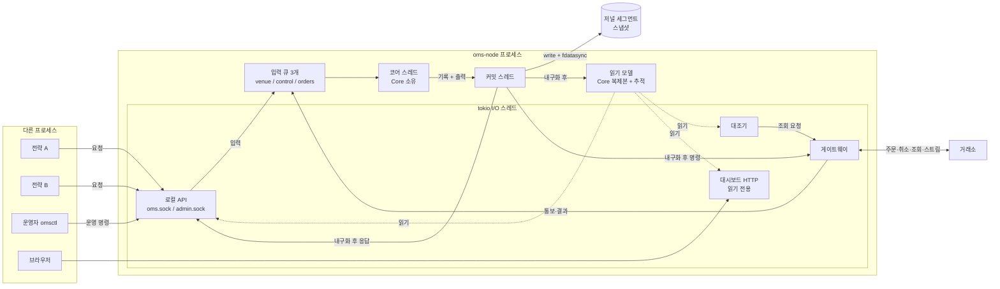
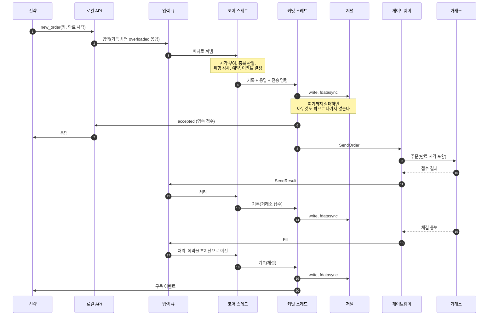

# 3. 전체 구조

이 문서는 프로세스·스레드·큐·저장소·외부 연결과 상태 소유권을 보여 준다.
정적인 구성(§3.1~3.3)과 실제 실행 순서(§3.4)를 구분한다.
각 요소의 선택 이유는 [설계 결정](adr/README.md)에, 경계별 동작은 [동작 계약](contracts/README.md)에 있다.

읽는 순서: 이 문서 → [설계 결정](adr/README.md) → [시나리오](scenarios.md) → [동작 계약](contracts/README.md) → [검증](verification/README.md).

## 3.1 배포 단위와 모듈

배포 단위는 `oms-node` 프로세스 하나다. 전략은 다른 프로세스이며 로컬 소켓으로 접속한다.

| crate | 내용 | 분리한 이유 |
|---|---|---|
| `oms-core` | 도메인 상태와 모든 판단. 의존성은 `serde`, `serde_json`뿐 | 의존성 경계가 "코어는 네트워크·파일·시계·난수에 접근하지 않는다"를 컴파일 단계에서 강제한다 |
| `oms-journal` | 저널 세그먼트와 스냅샷 파일. 내용은 불투명한 바이트 | 손상·잘림 처리를 주문 로직과 따로 시험한다. 오프라인 도구도 같은 코드를 쓴다 |
| `oms-api` | 로컬 소켓 프로토콜 타입과 작은 클라이언트, `omsctl` | 전략과 도구가 노드 전체에 의존하지 않고 프로토콜만 쓴다 |
| `oms-sim` | 결정적 시뮬레이터와 가상 거래소 모델 | 시험 전용. 배포 바이너리의 판단 경로에 들어가지 않는다 |
| `oms-node` | 실행 계층: 큐, 코어 스레드, 커밋 단계, 복구, 로컬 API, 게이트웨이, 대조기 | 배포 단위 |
| `xtask` | 측정, 문서 생성, 수용 시험 실행 | 개발 도구 |

게이트웨이에는 trait이 없다. 구현 둘(가상 거래소, Hyperliquid)을 시작할 때 설정으로 고르며,
지켜야 할 것은 채널로 주고받는 메시지 계약이다([C-GW](contracts/gateway.md)).

## 3.2 정적 구성도

실선은 처리 경로, 점선은 읽기 전용 접근이다.

## 3.3 상태 소유권

| 상태 | 권위 있는 소유자 | 변경 주체 | 복제본과 사용처 |
|---|---|---|---|
| 주문, 예약, 포지션 장부, 차단 사유, 대조 진행 | 코어 스레드의 `Core` | `Core::apply`만 | 읽기 모델의 `Core` 복제본(조회, 대조기, 대시보드) |
| 저널(결정된 사실의 순서) | 커밋 스레드의 `Writer` | 커밋 스레드만 | 오프라인 도구가 읽는다 |
| 내구화된 마지막 순번 | 커밋 스레드 | 커밋 스레드만 | `durable_seq` 원자 변수(상태 표시용) |
| 읽기 모델 | 커밋 스레드 | 커밋 스레드만 쓴다 | API·HTTP·대조기가 읽는다 |
| 거래소 연결과 세션 번호 | 게이트웨이 태스크 | 게이트웨이만 | 코어에는 `Link` 입력으로 전달 |
| nonce, 서명 키 | 게이트웨이 | 게이트웨이만 | 코어와 저널에 들어가지 않는다 |
| 대조 조회의 재시도 간격 | 대조기 | 대조기만 | 휘발성. 잃어도 조회가 한 번 더 나갈 뿐이다 |
| 거래소의 실제 주문·체결·포지션 | 거래소 | 거래소 | OMS는 통보와 조회로만 안다 |
| 요청 빈도 제한 토큰 | 로컬 API | 로컬 API | 휘발성. 재시작 시 가득 찬 상태로 시작 |

규칙 세 가지.

1. 주문 판단은 코어 스레드가 자기 `Core`만 읽고 내린다. 읽기 모델은 저널보다 앞서지 않지만 뒤처질 수 있으므로 판단에 쓰지 않는다.
2. 코어 스레드의 `Core`는 저널보다 앞설 수 있다. 그 앞선 부분에서 나온 출력은 커밋 단계가 내구화를 확인하기 전에는 밖으로 나가지 않는다.
3. 거래소 상태를 OMS가 덮어쓰지 않는다. 차이는 불일치(mismatch)로 기록하고 운영자가 명시적으로 조정한다.

## 3.4 실행 순서

### 신규 주문의 정상 경로

접수의 네 단계가 서로 다른 시점이다.

| 단계 | 의미 | 관측 지점 |
|---|---|---|
| 접수 | 요청이 입력 큐에 들어감. 아무 보장 없음 | 없음(응답하지 않는다) |
| 영속 접수 | 주문과 예약이 저널에 내구화됨 | `accepted` 응답 |
| 거래소 접수 | 거래소가 주문을 가졌다는 증거가 기록됨 | `order_acked` 이벤트 |
| 체결 | 체결이 장부에 반영되고 기록됨 | `fill_booked` 이벤트 |

### 스레드와 큐

| 요소 | 종류 | 상한 | 가득 찼을 때 |
|---|---|---|---|
| venue 큐 | `Mutex`+`Condvar`, `VecDeque` | 4096 | 게이트웨이가 기다린다. 소켓 읽기가 멈춘다 |
| control 큐 | 같음 | 256 | 요청 거절(overloaded) |
| orders 큐 | 같음 | 1024 | 요청 거절(overloaded) |
| 코어→커밋 | `std::sync::mpsc::sync_channel` | 8 배치 | 코어 스레드가 멈춘다. 입력 큐가 찬다 |
| 커밋→게이트웨이 명령 | `tokio::sync::mpsc` | 진행 중 전송 상한 + 열린 주문 상한 + 64 | 커밋 스레드가 기다린다 |
| 대조기→게이트웨이 조회 | `tokio::sync::mpsc` | 256 | 이번 회차 조회를 건너뛴다 |
| 연결별 응답 | `tokio::sync::mpsc` | 창 크기×2 + 64 | 응답 전달이 기다린다 |
| 구독자별 이벤트 | `tokio::sync::mpsc` | 4096(설정) | 그 구독을 끊고 연결을 닫는다 |
| 연결별 진행 요청 | 세마포어 | 32 | 다음 줄을 읽지 않는다 |
| 연결 수 | 세마포어 | 64 | 접속 거절 |

큐 밖에서 무한히 쌓이는 대기 태스크는 없다. 요청 하나당 응답 대기 태스크가 하나 생기며 그 수는 연결별 창 크기로 묶인다.

## 3.5 장애 시 남는 것

요약이다. 경계별 상세 표는 [C-COMMIT](contracts/commit.md)에 있다.

| 중단 시점 | 저널 | 거래소 | 재시작 후 |
|---|---|---|---|
| 코어가 결정했으나 내구화 전 | 없음 | 없음 | 요청이 없었던 것과 같다. 전략이 같은 키로 다시 보내면 새로 평가된다 |
| 내구화 후, 응답·전송 전 | 주문 있음 | 없음 | 전송 결과 불명으로 표시된다. 재전송하지 않는다. 만료 후 조회로 부재를 확인해 닫는다 |
| 전송 중 | 주문 있음 | 있을 수도 없을 수도 | 결과 불명. 조회로 찾으면 정상 진행, 못 찾으면 만료 후 닫는다 |
| 거래소 접수 기록 후 | 접수 있음 | 있음 | 대조로 그동안의 체결·취소를 반영한다 |

## 3.6 기준 버전

문서와 코드의 기준은 소스 다이제스트로 연결한다. git 저장소가 없기 때문이다.
`oms-node version`이 출력하는 `src:` 값과 [verification/README.md](verification/README.md)의 값이 같으면 같은 코드다.
다이제스트는 `crates/` 아래의 `.rs`, `Cargo.toml`과 `Cargo.lock`을 정렬해 FNV-1a 64로 접은 값이다(`crates/oms-node/build.rs`).
