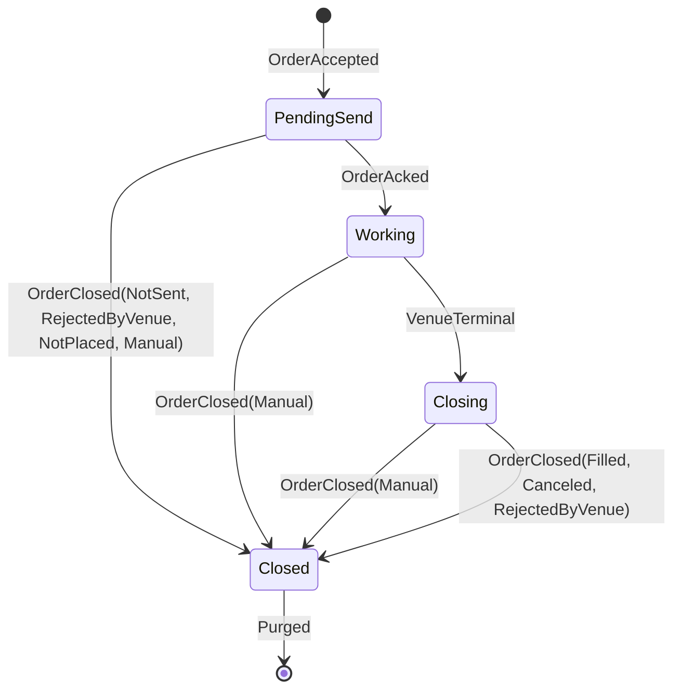

# 주문 생명주기 계약

설계 근거: [ADR-005](../adr/ADR-005-unknown-outcome.md), [ADR-007](../adr/ADR-007-order-state.md), [ADR-008](../adr/ADR-008-risk-reservation.md).
구현: `crates/oms-core/src/decide.rs`(판단), `crates/oms-core/src/core.rs`(`apply`).

모든 계약에 공통인 것: 상태 소유자는 코어 스레드의 `Core`다. 읽는 상태도 그것뿐이다.
확정 시점은 그 입력의 기록이 내구화될 때다([C-COMMIT](commit.md)). 프로세스가 중단되면 내구화된 이벤트까지만 남는다.

## 단계 전이

`PendingSend`에는 결과 불명 표시(`doubt`)가 붙을 수 있다. 취소 요청(`cancel`)은 `Closed`가 아닌 모든 단계에 붙을 수 있다.
접수 증거와 종결 통보가 한 입력에 함께 오면 `OrderAcked`가 먼저 기록되어 `Working`을 거친다.

## C-NEW 신규 주문 수용

| 항목 | 내용 |
|---|---|
| 입력 | `NewOrder { strategy, client_order_id, instrument, side, qty, px, tif, reduce_only, expires_at }` |
| 읽는 상태 | 설정, 멱등성 색인, 계좌·전략 장부, 차단 사유, 참조 가격, 열린 주문 수 |
| 변경 | 수용: `OrderAccepted` → 주문 생성(`PendingSend`), 장부의 `B` 또는 `S` 증가, 색인 등록, 다음 주문 ID 증가. 거절: `RequestRejected` → 통계만 |
| 외부 효과 | 수용 시 내구화 뒤 `accepted` 응답과 `SendOrder` 명령 한 번. 거절 시 사유 코드 응답 |
| 자원 상한 | 열린 주문 500, 진행 중 전송 64, 메모리의 주문 100,000(모두 설정). 넘으면 거절 |

검사 순서와 사유 코드는 [ADR-008](../adr/ADR-008-risk-reservation.md) §7의 표와 같다. 사유는 해당하는 것을 모두 돌려준다.

| 상황 | 동작 |
|---|---|
| 같은 요청이 다시 옴 | [C-IDEM](idempotency.md). 주문이 있으면 `duplicate`, 변화 없음 |
| 순서: 두 전략의 요청 | 먼저 처리된 것이 여유를 가져간다. 뒤의 것은 남은 여유로 검사된다 |
| 내구화 전 중단 | 주문 없음. 전송 없음 |
| 내구화 후 중단 | 주문 있음. 재시작 시 결과 불명([C-BOOT](recovery.md#c-boot-재시작)) |

## C-SEND 전송 결과

게이트웨이는 `SendOrder` 하나에 `SendResult` 하나를 돌려준다([C-GW](gateway.md)).

| 결과 | 조건(게이트웨이의 판단) | 코어의 동작 |
|---|---|---|
| `Placed { venue_oid, status }` | 거래소가 주문을 놓았다고 응답 | `OrderAcked`. `status`를 주문 상태 통보로 이어서 처리 |
| `Rejected { reason }` | 거래소의 명시적 거부 | `OrderClosed(RejectedByVenue)`. 예약 전부 해제 |
| `NotSent { reason }` | 요청이 호스트를 떠나지 않았음이 확실 | `OrderClosed(NotSent)`. 예약 전부 해제 |
| `Unknown { reason }` | 그 밖의 모든 경우 | `OrderInDoubt(Transport)`. 예약 유지 |

| 상황 | 동작 |
|---|---|
| 결과보다 스트림 통보나 체결이 먼저 옴 | 그 증거로 `OrderAcked`. 뒤에 온 `Placed`는 변화 없음, `Unknown`은 무시(이미 증거가 있다) |
| 이미 접수된 주문에 `Rejected`/`NotSent` | 모순. `StatusConflict` 불일치 |
| 거래소 주문 ID가 이미 다른 주문의 것 | 그 ID를 받아들이지 않는다. `StatusConflict` 불일치. 주문의 상태는 바뀌지 않는다 |
| 링크가 바뀐 뒤에 도착한 `Placed` | 접수로 처리한다. 다만 "현재 세션의 증거"로 세지 않으므로 그 주문은 상태 조회로 다시 확인된다 |
| 결과가 전혀 오지 않음 | 30초 뒤 `Tick`에서 `OrderInDoubt(NoResult)` |
| 결과가 두 번 옴 | 두 번째는 단계가 달라 변화 없음 |
| 전송 중 프로세스 중단 | 결과는 영영 오지 않는다. 재시작 시 `OrderInDoubt(Restart)` |

시스템이 외부 결과를 아는가: `Placed`와 `Rejected`는 거래소의 응답이므로 안다. `NotSent`는 게이트웨이가 안다. `Unknown`은 모른다는 사실을 기록한 것이다.

## C-DOUBT 결과 불명의 해소

| 항목 | 내용 |
|---|---|
| 전제 | 단계 `PendingSend`, `doubt` 있음 |
| 변경 | 불명인 동안 없음. 예약은 `qty − cum_qty` 그대로 |
| 차단 | 계좌 전체에 `InDoubt` |
| 해소 1 | 주문의 존재 증거(상태 조회, 스트림 통보, 열린 주문 목록, 체결) → `OrderAcked` |
| 해소 2 | `StatusNotFound { queried_at }`이고 `queried_at ≥ expires_at + absence_margin`이며 `venue_enforces_expiry` → `OrderClosed(NotPlaced)` |
| 해소 3 | 운영자의 `resolve` 명령 → `OrderClosed(Manual)` |

| 상황 | 동작 |
|---|---|
| 만료 전의 "없음" | 무시. 요청이 아직 닿을 수 있다 |
| 불명이 아닌 전송 대기 주문에 대한 "없음" | 무시. 전송과 조회가 엇갈린 것이다 |
| "없음"으로 닫은 뒤 주문이 나타남 | 가정 A-01, A-02의 붕괴. 전송 응답, 상태 통보, 열린 주문 목록 중 어느 것으로든 주문이 열려 있다고 나오면 `OpenAfterClose`를 제기한다. 체결이 오면 기장하고 `FillAfterClose`. 버려지는 증거는 없다 |
| 접수된 뒤의 주문에 대한 "없음" | 거래소가 한 번 인정한 주문을 모른다고 한 것이다. 닫지 않는다(체결 여부를 알 수 없다). 접수 시각 + 여유 뒤의 조회라면 `StatusConflict`를 제기해 운영자가 보게 한다 |
| 불명 중 취소 요청 | 클라이언트 ID로 취소를 보낸다. 주문이 있으면 취소되고 없으면 거부된다. 어느 쪽도 불명을 해소하지 않는다 |
| 재전송 | 하지 않는다. 어떤 경로로도 `SendOrder`는 다시 나오지 않는다 |

복구 후 무엇을 다시 하는가: 조회만 다시 한다. 조회는 몇 번이든 안전하다.

## C-FILL 체결 기장

| 항목 | 내용 |
|---|---|
| 입력 | `Fill { key, order_id?, venue_oid?, instrument, side, qty, px, fee, venue_ts }` |
| 읽는 상태 | 체결 키 집합, 바닥 시각, 주문, 대기 체결 목록 |
| 변경 | `FillBooked`: 주문의 `cum_qty`·금액·수수료 증가, 예약 감소(체결량과 남은 예약 중 작은 쪽), 계좌·전략 장부의 포지션 이동, 체결 키 등록 |
| 외부 효과 | 구독 이벤트 |
| 자원 상한 | 대기 체결 1024건. 체결 키는 동기화 시점 기준 24시간분. 누적 거래량·금액·수수료 같은 통계 합계는 넘치면 최댓값에 머문다(체결 기장을 멈추지 않는다) |

판단 순서:

0. 수량이 0 이하면 체결이 아니다. 무시.
1. 키가 이미 기장됐거나 대기 중이면 무시.
2. `venue_ts`가 바닥 시각보다 앞이면 무시(재전달).
3. 주문을 찾는다. `order_id`(게이트웨이가 클라이언트 ID에서 복원), 없으면 `venue_oid`.
4. 찾았고 종목·방향이 맞으면 기장한다. `PendingSend`였으면 먼저 `OrderAcked`. 이 체결로 거래소 주문 ID를 알게 됐으면 그 ID로 기다리던 대기 체결도 이어서 기장한다.
5. 기장 뒤 `cum_qty ≥ qty`이면 `VenueTerminal(Filled)`와 `OrderClosed(Filled)`.
6. 못 찾았는데 거래소 주문 ID를 아직 모르는 같은 종목·방향의 우리 주문이 있으면 `FillParked`.
7. 그 밖에는 `ExternalFillBooked`(계좌와 미귀속 장부에 기장) + `ExternalFill` 불일치.

| 상황 | 동작 |
|---|---|
| 같은 체결이 두 번 | 1에서 무시. 기록 없음 |
| 체결이 접수 응답보다 먼저 | 4에서 접수 처리 후 기장 |
| 체결이 종결 통보보다 늦게 | 주문은 `Closing`에서 기다리고 있다. 기장 후 조건이 맞으면 닫는다 |
| 주문 수량을 넘는 체결 | 전량 기장. `Overfill` 불일치. 예약은 0 아래로 가지 않는다 |
| 종결된 주문에 체결 | 종결 사유가 무엇이든(체결, 취소, 부재, 수동) 그 주문과 전략에 기장한다. `FillAfterClose` 불일치 |
| 주문이 메모리에서 제거된 뒤의 재전달 | 1 또는 2에서 무시 |
| 주문이 메모리에서 제거된 뒤의 **새** 체결 | 주인을 찾을 수 없다. 7로 간다: 계좌와 미귀속 장부에 기장하고 `ExternalFill`. 전략 장부에는 들어가지 않는다 |
| 주문과 종목·방향이 다른 체결 | 주문에는 기장하지 않는다. 계좌와 미귀속 장부에 기장하고 `FillFieldConflict` |
| 설정에 없는 종목의 체결 | 7로 간다. 결함으로 멈추지 않는다 |
| 외부 체결이 계속 옴 | 체결마다 기장한다. 불일치는 종목마다 한 건으로 남고 확인되면 다음 체결에서 다시 뜬다 |
| 대기 체결의 주인이 밝혀짐 | `FillUnparked` 후 기장 |
| 대기 체결의 주인 후보가 없어지거나 120초 경과 | `FillUnparked` 후 7 |
| 기장 전 프로세스 중단 | 기장되지 않았다. 재시작 뒤 대조가 다시 가져온다 |

코어에 들어온 체결 통보가 기장되지 않는 경우는 셋뿐이다: 수량이 0 이하인 것, 이미 기장됐거나 대기 중인 키, 바닥 아래의 재전달(`the_three_ways_a_fill_input_changes_nothing`).
게이트웨이가 코어로 넘기지 않는 체결이 하나 있다: 같은 계좌의 spot 체결처럼 perp 종목 목록에 없는 것. 경고 로그만 남는다([C-GW](gateway.md)).

### 우리 주문의 체결이 아닌 실행([ADR-023](../adr/ADR-023-venue-made-executions.md))

거래소는 체결과 같은 흐름으로 다른 실행도 보낸다(Bybit `execType`). 게이트웨이가 분류해 아래 입력으로 넘긴다. 키는 체결 키와 같은 집합에서 중복을 거른다(이미 본 키, 바닥 아래의 시각은 무시).

| 입력 | 이벤트 | 변경 | 차단 |
|---|---|---|---|
| `Funding { key, instrument, amount, rate, venue_ts }`(현금만, `amount` 양수 = 계좌가 냄) | `FundingBooked` | 키 등록, 통계. 포지션·주문·예약·체결 수는 그대로 | 없음 |
| `PositionChange { key, kind: adl\|takeover\|delivery\|settle, instrument, qty(부호 있음), px, venue_ts }` | `VenuePositionChanged` + `VenuePositionChange` 불일치 | 계좌와 미귀속 장부의 포지션에 `qty`를 더함, 키 등록, 그 종목을 "거래소 포지션 대기"로 표시 | 불일치 차단(감소 전용은 통과, 증거금 정책이 있을 때) |
| `UnclassifiedExecution { key, instrument, exec_type, detail, venue_ts }` | `UnclassifiedExecutionNoted` + `UnclassifiedExecution` 불일치 | 키 등록. 기장하지 않음 | 같음 |

거래소 포지션 대기 중인 종목은, 현재 링크 세션의 포지션 응답 중 변경 기록 시각보다 뒤에 물은 첫 응답이 포지션을 정한다(그 시각 이후 체결이 없을 때. 기존 규칙). 다르면 `PositionAdjusted { ledger: unattributed, delta, reason: snapshot_after_venue_change }`, 같으면 `VenueChangeSettled`. 어느 쪽이든 대기가 끝난다. 그래서 저널만 읽어도 포지션 = 기장된 체결 + 외부 체결 + `VenuePositionChanged` + `PositionAdjusted` 수량의 합이다.

우리 주문이 아닌 주문의 체결(Bybit `Trade` + 모르는 `orderLinkId`)은 이 표가 아니라 위 7(외부 체결)로 간다.

## C-CANCEL 취소

| 항목 | 내용 |
|---|---|
| 입력 | `Cancel { actor, target }`. 대상은 주문 ID 또는 (전략, 클라이언트 주문 ID) |
| 변경 | `CancelRequested` → 취소 상태 생성. 보낼 수 있으면 `CancelSent { attempt }` |
| 외부 효과 | `SendCancel` 명령. 응답 `requested` |
| 예약 | **변하지 않는다.** 취소 요청은 종결의 증거가 아니다 |
| 자원 상한 | 한 번의 요청에 시도 5회(설정). 재시도 간격 1초. 결과를 기다리는 시간 30초 |

보낼 수 있는 조건: 링크가 올라와 있고, 단계가 `Working`이거나 결과 불명인 `PendingSend`이고, 진행 중인 시도가 없고, 확인되지 않았고, 시도 횟수와 간격이 허용한다.
조건이 안 되면 요청만 기록하고, 조건이 될 때(접수, 재접속, `Tick`) 보낸다.

| 취소 결과 | 동작 |
|---|---|
| `Confirmed` | 확인 표시. 종결은 따로 온다(스트림 또는 조회) |
| `Rejected` | 기록. 대조기가 주문 상태를 조회한다. Hyperliquid의 거부 문구는 "없음·이미 취소·이미 체결"을 구분하지 않으므로, 종결 증거가 오기 전까지는 간격 뒤 다시 시도한다(시도 상한 안에서) |
| `Unknown`, `NotSent` | 간격 뒤 재시도 |
| 결과가 30초 안에 오지 않음 | `Tick`에서 `Unknown`으로 기록하고 재시도 |
| 5회 뒤에도 미확인 | `CancelStuck` 불일치. 그 시점에 한 번 제기한다. 확인 처리하면 다시 뜨지 않는다 |

시도 상한은 요청마다다. 상한에 이른 뒤 전략이나 운영자가 취소를 다시 요청하면(`cancel`, `cancel-all`) 새로 5회가 주어진다. 시도 번호는 이어서 센다.
결과 불명인 동안 쓴 시도는 주문이 발견되는 순간 계산에서 뺀다: 없는 주문에 대한 취소가 거부된 것은 주문이 나타난 뒤의 취소와 무관하다.

| 상황 | 동작 |
|---|---|
| 같은 취소가 두 번 | `already_requested`. 변화 없음. 시도가 상한에 이른 뒤라면 새 요청으로 받아 `requested` |
| 남의 주문 취소 | `not_owner` |
| 종결된 주문 취소 | `already_closed` |
| 취소 중 체결 | 체결을 기장한다. 최종 수량은 종결 통보나 체결 동기화가 정한다 |
| 차단 중 취소 | 받는다. 차단은 신규 주문에만 적용된다 |
| 링크가 내려가 있을 때 취소 | 요청을 기록한다. 링크가 돌아오면 보낸다 |
| 취소 시도 중 프로세스 중단 | 재시작 시 `CancelOutcomeNoted(LostOnRestart)`. 링크가 돌아오면 다음 시도를 보낸다 |

복구 후 무엇을 다시 하는가: 취소는 다시 보낸다. 반복해도 효과가 같기 때문이다.

## C-TERM 종결

| 항목 | 내용 |
|---|---|
| 입력 | 주문 상태 통보(`Filled`, `Canceled`, `Rejected`), 체결, 체결 동기화 |
| 변경 | `VenueTerminal` → `Closing`, 예약을 `max(final_cum − cum, 0)`으로 축소(최종 누적을 알 때). `OrderClosed` → `Closed`, 예약 0, 열린 주문 수 감소 |

닫는 조건은 [ADR-007](../adr/ADR-007-order-state.md) §7의 종결 규칙이다.

| 질문 | 답 |
|---|---|
| 중간에 멈추면 무엇이 남는가 | `VenueTerminal`만 내구화되고 멈추면 `Closing`으로 복원된다. 예약은 남은 만큼 유지된다. 재시작 뒤 체결 동기화가 종결 시각을 지나면 닫힌다 |
| 누가 언제 보는가 | 구독자는 `venue_terminal`과 `order_closed`를 내구화 뒤에 받는다. 예약 해제는 `order_closed`가 내구화된 다음 입력부터 한도 검사에 반영된다 |
| 외부 결과를 아는가 | 종결 통보는 거래소의 말이다. 최종 누적 수량은 통보에 있을 때만 안다. 없으면 체결 동기화가 끝난 뒤의 기장 합계를 최종으로 본다 |
| 복구 뒤 무엇을 다시 하는가 | 조회만. `Closing`인 주문은 체결 조회의 대상이 된다 |

| 상황 | 동작 |
|---|---|
| 종결 통보가 두 번 | 최종 누적이 같으면 무시. 처음에 몰랐던 최종 누적을 알려 주면 갱신. 다르면 `StatusConflict` |
| 최종 누적 < 기장된 체결 | `CumExceedsFinal` 불일치. 기장은 유지하고 닫는다 |
| 최종 누적 > 기장된 체결이고 동기화가 종결 시각을 지남 | `MissingFills` 불일치. `Closing`에 머물고 예약 유지 |
| 종결 뒤 "열림" 통보 | 접수된 적 있는 주문이면 무시(늦게 온 옛 통보). 조회 시각이 종결 뒤인 열린 주문 목록에 있으면 `OpenAfterClose`. 접수된 적 없이 닫은 주문이면 `OpenAfterClose`(C-DOUBT) |
| 표에 없는 상태 이름(Hyperliquid) | 게이트웨이가 코어로 넘기지 않고 오류로 남긴다. 주문은 그대로다 |
| 거래소가 요청 없이 취소(증거금, 자전거래 방지 등) | 같은 경로. 사유 문자열이 종결 기록에 남는다 |

## 검증

| 계약 | 시험(대표) |
|---|---|
| C-NEW | `scenarios::fia_7_1_…`, `concurrent_requests_cannot_double_spend_headroom`, `field_validation_reasons`, `capacity_limits_…` |
| C-SEND | `fill_before_send_result_acknowledges_the_order`, `definite_gateway_failures_close_and_release`, `a_send_without_any_result_becomes_in_doubt_after_the_timeout` |
| C-DOUBT | `unknown_send_outcome_keeps_the_reservation…`, `not_found_closes_…_only_after_expiry_plus_margin`, `e2e::a_lost_request_is_closed_only_after_its_send_window` |
| C-DOUBT(닫은 뒤 나타남) | `review_core::f3_placed_evidence_for_an_order_closed_as_not_placed_is_flagged`, `gaps::an_acknowledged_order_the_venue_no_longer_knows_is_reported_not_closed` |
| C-FILL | `duplicate_fill_is_booked_once`, `fill_by_venue_id_before_the_id_is_known_…`, `overfill_is_booked_in_full_and_flagged`, `review_core::f2_…`, `gaps::a_fill_after_any_kind_of_close_…`, `gaps::a_fill_for_a_purged_order_…`, `gaps::the_three_ways_…`, 시뮬레이션 `weak_evidence` |
| C-CANCEL | `cancel_race_final_status_decides`, `cancel_is_retried_with_backoff_and_then_flagged`, `cancels_are_accepted_while_new_orders_are_held`, `review_core::f1_…` 5건 |
| C-TERM | `terminal_before_fills_keeps_the_unbooked_quantity_reserved`, `terminal_without_final_quantity_waits_for_fill_sync`, `missing_fills_after_sync_…` |
| 전체 조합 | 시뮬레이션 7개 프로파일, `e2e::vertical_slice_…`, `e2e::random_kills_…` |
